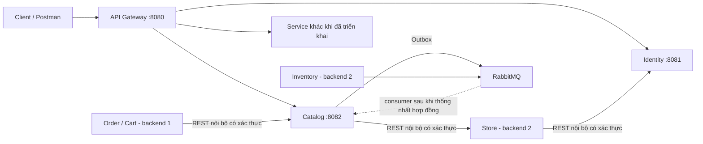

# Ranh giới và tích hợp backend 1 / backend 2

Đối chiếu code hiện tại với `SmartAPI.xlsx` và `SmartCoffeeDT.sql`. Checkout này chưa có phần nghiệp vụ của backend 2 để chạy kiểm thử liên thông. Một route có trong Gateway không có nghĩa service đích đã được triển khai hoặc đang chạy.

| Người phụ trách | Service và dữ liệu sở hữu |
| --- | --- |
| Backend 1 | Identity: tài khoản, vai trò, xác thực. Catalog: danh mục, sản phẩm, biến thể, tùy chọn, giá, ngoại lệ khả dụng. Order: giỏ/đơn và snapshot. Engagement: tương tác/thông báo. |
| Backend 2 | Store: chi nhánh, bàn, phiên bàn, Staff_Profiles, phân công nhân viên. Payment: thanh toán/hoàn tiền. Inventory: nguyên liệu, tồn kho, công thức. Intelligence: AI. |

Mỗi service dùng database riêng. Không JOIN bảng của service khác, không nối trực tiếp datasource của service khác, không tạo khóa ngoại xuyên database. `branch_id`, `user_id`, `variant_id` ở service khác chỉ là ID tham chiếu; kiểm tra dữ liệu qua hợp đồng API/event của bên sở hữu.

## Các đường giao tiếp



- Client gọi Gateway; Gateway tìm instance qua Eureka và định tuyến. Ví dụ `/api/v1/catalog/products` tới Catalog. Khi service đích chưa chạy/đăng ký, Gateway không tự cung cấp dữ liệu thay thế.
- Service có thể gọi REST nội bộ trực tiếp bằng địa chỉ được cấu hình hoặc service discovery, kèm thông tin xác thực service. Đây vẫn là microservice đúng ranh giới. Không bắt buộc đi vòng qua Gateway công khai.
- API `/internal/**` của Identity/Catalog bị chặn tại Gateway công khai. Nếu đội muốn mọi giao tiếp HTTP qua gateway, cần một gateway nội bộ được bảo vệ riêng; không mở các internal API ra cổng công khai.
- Sự kiện chạy qua RabbitMQ, không qua HTTP Gateway. Outbox bảo đảm ghi dữ liệu và ý định phát sự kiện cùng transaction của service phát; không tạo transaction ACID xuyên nhiều database.

## Phụ thuộc cần thống nhất với backend 2

| Luồng | Hợp đồng trong thiết kế | Trạng thái hiện tại |
| --- | --- | --- |
| Catalog → Store | `GET /internal/branches/{id}` để xác minh chi nhánh | Đã có HTTP adapter thật, URL/auth chưa cấu hình mặc định. Thiếu cấu hình trả 503; không tạo chi nhánh giả. |
| Catalog có `branch_id` | GET products, GET product detail, hai PUT availability, POST internal resolve | Cần Store xác minh tồn tại trước khi xử lý theo chi nhánh. Không có branch_id thì xem menu toàn hệ thống độc lập. |
| Inventory → Catalog | `inventory.ingredient.low_stock` / `inventory.ingredient.restocked`, có `affected_variant_ids` | Consumer mặc định tắt. Cần thống nhất broker/vhost/exchange, schema, tính đầy đủ và thứ tự sự kiện trước khi bật. Chưa kiểm thử với backend 2. |
| Catalog → các service tiêu thụ | `catalog.variant.price_changed`, `catalog.product.status_changed` | Ghi Outbox cùng transaction; publisher gửi RabbitMQ. Consumer/queue phía backend 2 do backend 2 triển khai. Không giả lập đã tiêu thụ. |
| Store → Identity | `GET /internal/users/{id}`, `POST /internal/users/batch` để lấy thông tin tài khoản | Đã có API đọc thật từ DB Identity; nay cần X-Service-Key. Store không được đọc DB Identity. |
| Store → Identity khi onboard | Store tạo Staff_Profiles từ user_id có sẵn, hoặc cần Identity tạo tài khoản Staff | API internal tạo tài khoản Staff chưa có trong code hiện tại; hai bên cần chốt contract và bù trừ nếu tạo profile thất bại. Không tự đoán endpoint/response. |
| Store → Identity khi nghỉ việc | `store.staff.terminated` để vô hiệu hóa tài khoản | Chưa có consumer nghiệp vụ này trong Identity. Cần phối hợp với backend 2; chưa tuyên bố đã đồng bộ. |
| Identity / Manager → Store | Tra cứu hồ sơ/phân công để kiểm tra quyền theo chi nhánh | Chưa tích hợp. Không lấy branch_id do client gửi làm bằng chứng phân quyền, không tự điền branch_id vào JWT. |
| Order → Store | `GET /internal/branches/{id}`, `GET /internal/table-sessions/{id}` | Luồng nghiệp vụ Order chưa triển khai trong checkout này. Cần backend 2 khi thực hiện. |
| Order ↔ Payment | Tạo thanh toán/hoàn tiền và nhận payment succeeded/failed/expired/refunded | Chưa tích hợp; không trả thanh toán thành công giả. Contract theo sheet Order/Payment. |
| Order ↔ Inventory | Sự kiện đơn hàng và giữ/trừ/hoàn tồn theo thiết kế | Chưa tích hợp; không tự giả định đủ tồn. |
| Engagement ↔ Intelligence | Dữ liệu/sự kiện phục vụ AI nếu triển khai chức năng này | Chưa tích hợp trong checkout hiện tại. OTP email Identity → Engagement đang thuộc backend 1. |

Catalog tự sở hữu hai bảng Branch_*_Availability dù `branch_id` thuộc Store. Đây là trạng thái bán của Catalog, không phải bảng tồn kho hay bản sao Branches. Không có dòng ngoại lệ nghĩa available theo quy ước Catalog, **không chứng minh Inventory đã xác nhận đủ nguyên liệu**. Đơn hàng vẫn cần quy trình kiểm tra/giữ tồn của Inventory.

Excel hiện chỉ nêu `affected_variant_ids` cho sự kiện Inventory; code không tự đọc một trường `affected_option_ids` chưa thống nhất. Một nguyên liệu vừa nhập lại cũng chưa đủ chứng minh biến thể bán được nếu còn thiếu nguyên liệu khác. Vì vậy handler restocked hiện từ chối tự bật lại biến thể, không đánh dấu event đã xử lý; nếu bật consumer thử nghiệm thì event này đi qua retry/DLQ để đối soát. Cần chốt Inventory cung cấp danh sách khả dụng có tính kết luận hoặc một API kiểm tra tồn trước khi hoàn thiện tự động hóa restock. Quy tắc ưu tiên ngoại lệ thủ công, sự kiện đến sai thứ tự và phân quyền Manager theo chi nhánh cũng cần được chốt; không xem consumer đang tắt là tích hợp đã hoàn tất.

## Những sai lệch đã chặn/sửa

1. Catalog trước đây chỉ kiểm tra branch_id dương rồi đọc dữ liệu cục bộ. Nay gọi Store xác minh; Store không sẵn sàng thì trả lỗi, không fallback thành công.
2. Seed cũ gán chi nhánh 1/2 dù chưa có Store. Đã bỏ đoạn tạo availability theo ID tự đặt. Không tự xóa dữ liệu người dùng đã chạy từ trước.
3. Identity AdminUserService nhận branch_id nhưng bỏ qua. Nay trả 400 với thông báo chi nhánh/Staff_Profiles thuộc Store. Tạo tài khoản Admin/Manager không kèm branch_id vẫn là việc của Identity.
4. Các route Identity `/manager/staff` cũ chưa giới hạn nhân viên theo phân công Store. Đã chặn bằng `503 STORE_INTEGRATION_REQUIRED` trước khi truy vấn/sửa dữ liệu, tránh trả danh sách nhân viên toàn hệ thống như thể là danh sách của chi nhánh. Đây là thay đổi hành vi có chủ đích, không phải Store đã được triển khai.
5. Identity internal users trước đây permitAll mà chưa xác thực service. Đã thêm kiểm tra X-Service-Key. Chặn `/internal/**` tại Gateway công khai không thay thế việc xác thực ở service đích.
6. Không có truy vấn runtime sang DB backend 2 trong các service backend 1 đã kiểm tra. Không triển khai thay Store/Payment/Inventory/Intelligence và không tạo dữ liệu runtime giả cho chúng.

## Cấu hình sau khi hai bên đã thống nhất

Catalog:

```text
STORE_INTERNAL_BASE_URL=<URL thật, gồm tiền tố /internal hoặc /api/v1/internal>
STORE_INTERNAL_AUTH_HEADER=<tên header backend 2 thực sự hỗ trợ>
STORE_INTERNAL_AUTH_VALUE=<giá trị xác thực đã cấp>
CATALOG_INTERNAL_API_KEY=<khóa riêng cho service được phép gọi resolve>
CATALOG_INVENTORY_CONSUMER_ENABLED=false
```

Adapter nối thêm `/branches/{id}` vào base URL. Hợp đồng đọc hiện dùng envelope chung Excel: `{"success":true,"data":{"id":<id yêu cầu>,...}}`. Store trả 404 → Catalog trả `404 BRANCH_NOT_FOUND`; lỗi/timeout/phản hồi sai → `503 STORE_UNAVAILABLE`. Cần khớp envelope với code thật của backend 2 trước khi tích hợp. Không cấu hình giả chỉ để tránh lỗi 503.

Identity:

```text
IDENTITY_INTERNAL_API_KEY=<khóa cấp cho service tiêu thụ API internal users>
```

Caller gửi X-Service-Key đến Identity/Catalog. Thiếu khóa trả 401, sai khóa 403; server chưa có cấu hình khóa trả 503 khi caller đã gửi thông tin xác thực. JWT người dùng không thay thế khóa nội bộ. Không đưa các khóa này vào frontend hay commit giá trị thật.

Gateway, Identity và Catalog dùng cùng JWT_SECRET theo cấu hình hiện tại. JWT chứng minh vai trò tài khoản; không chứng minh nhân viên thuộc chi nhánh khi chưa có dữ liệu phân công Store.

## Phạm vi kiểm thử

Test H2, fixture và HTTP server mẫu chỉ tồn tại trong `src/test`. Mock Store dùng để kiểm tra logic Catalog độc lập; không phải fallback production, không chứng minh backend 2 hoạt động. Test riêng dùng adapter production với cấu hình Store trống xác nhận các luồng phụ thuộc trả 503 và không ghi availability.

Script `catalog-service/tools/check-category-admin-mysql.py` tạo DB MySQL thử nghiệm riêng, chạy JVM Catalog thật, kiểm tra schema/transaction/API rồi dừng JVM và xóa đúng DB thử nghiệm. Không đụng dữ liệu thực của các service. Kiểm thử Gateway kiểm tra xác thực, chuyển trace và chặn internal. Tích hợp thật với backend 2 và RabbitMQ cần chạy tiếp khi có code/cấu hình của người phụ trách.
