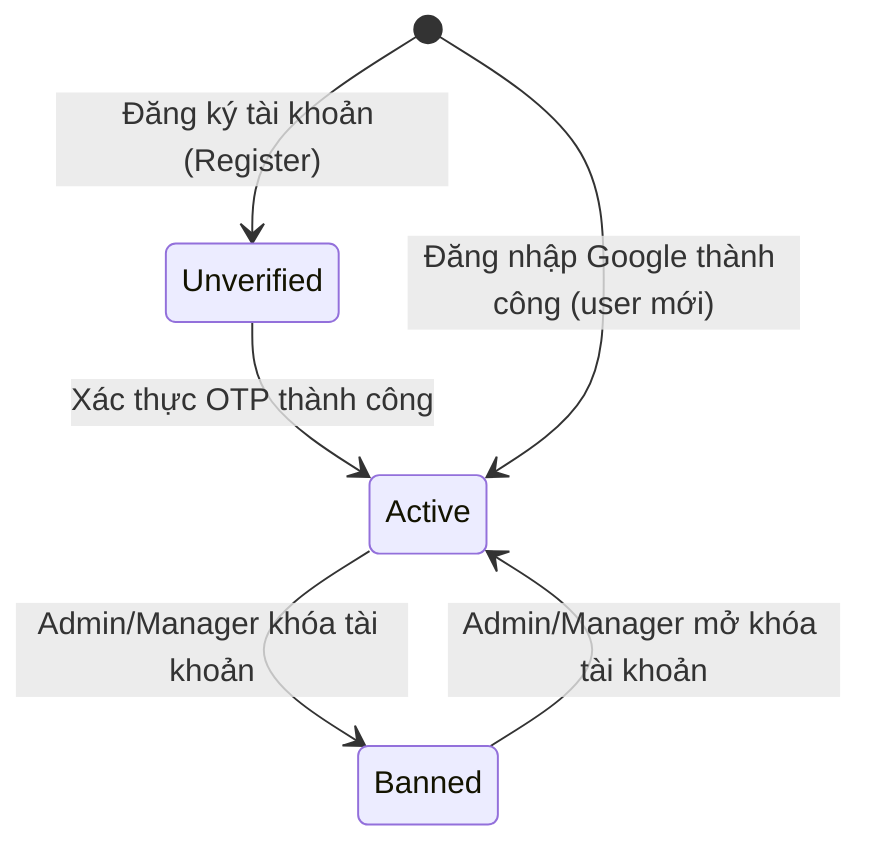
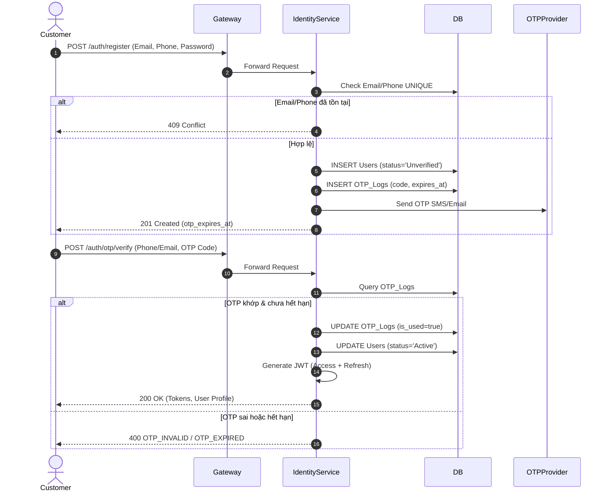

# 01. Identity Service Specification

## 1. Document Information
- **Service Name:** Identity Service
- **System:** Smart Café AI System (Microservices Architecture)
- **Database:** `smart_cafe_identity_db`
- **Port:** `8081`
- **Gateway Prefixes:** `/auth`, `/users`, `/manager/staff`, `/admin/users`, `/admin/roles`
- **Version:** 1.0
- **Date:** 28/09/2026

---

## 2. Service Overview
Identity Service là dịch vụ trung tâm chịu trách nhiệm quản lý xác thực (Authentication), phân quyền (Authorization - RBAC), quản lý thông tin tài khoản người dùng, tài khoản nhân viên/quản lý, địa chỉ giao hàng và quy trình cấp phát/kiểm tra mã xác thực OTP. Tất cả các request đi qua API Gateway đều relying vào token JWT được cấp phát từ Identity Service.

---

## 3. Responsibilities & Scope

### 3.1 Responsibilities
- Đăng ký, đăng nhập tài khoản bằng Mật khẩu, Google OAuth 2.0.
- Sinh, gửi và xác thực OTP qua Email/SMS cho các luồng đăng ký, quên mật khẩu và đổi thông tin liên hệ.
- Phát hành, làm mới (refresh) và vô hiệu hóa (logout/blacklist) JWT Token.
- Quản lý vai trò (Roles) và tài khoản người dùng (Users) với cơ chế Phân quyền dựa trên Vai trò (RBAC).
- Quản lý hồ sơ cá nhân và danh sách địa chỉ giao hàng của khách hàng.
- Cung cấp API nội bộ cho các service khác lấy thông tin user tối thiểu (Batch User Resolution).

### 3.2 In Scope
- Xác thực khách hàng (Customer), nhân viên (Staff), quản lý (Manager), admin.
- Đổi mật khẩu, đặt lại mật khẩu bằng OTP.
- CRUD địa chỉ giao hàng (Addresses), quản lý địa chỉ mặc định.
- Quản lý danh sách nhân viên theo chi nhánh (`branch_id`).
- Quản trị toàn bộ Users và Roles dành cho Admin.

### 3.3 Out of Scope
- Quản lý chấm công, lịch làm việc của nhân viên (do Workforce Service đảm nhận).
- Quản lý ca thu ngân (do Payment Service đảm nhận).
- Lưu trữ nhật ký audit truy cập toàn hệ thống (do Platform Service đảm nhận).

---

## 4. Actors
- **Customer:** Đăng ký, đăng nhập, quản lý profile, đổi mật khẩu, xem/thêm/sửa/xóa địa chỉ giao hàng.
- **Staff:** Đăng nhập, xem profile cá nhân.
- **Manager:** Quản lý tài khoản nhân viên thuộc chi nhánh phụ trách (`GET/POST/PUT/PATCH /manager/staff`).
- **Admin:** Quản lý toàn bộ người dùng hệ thống (`/admin/users`), tạo và phân quyền vai trò (`/admin/roles`).
- **Internal Service:** Lấy thông tin user tối thiểu qua `/internal/users/{id}` và `/internal/users/batch`.

---

## 5. Business Functions
1. **Xác thực & OTP:** Register, Verify OTP, Resend OTP, Login, Google Auth, Refresh Token, Logout, Forgot Password, Reset Password, Change Password.
2. **Hồ sơ cá nhân:** View Profile (`/users/me`), Update Profile, Change Contact (Email/Phone + OTP), Upload Avatar.
3. **Địa chỉ giao hàng:** List Addresses, Create Address, View Address Detail, Update Address, Set Default Address, Delete Address.
4. **Quản lý nhân viên (Manager):** List Staff by Branch, Create Staff, Staff Detail, Update Staff, Lock/Unlock Staff (`status`).
5. **Quản trị tài khoản & vai trò (Admin):** List Users, User Detail, Create User, Update User, Change User Role/Branch, Change Status, Admin Reset Password, Roles CRUD.
6. **Internal API:** Batch User lookup cho Workforce, Order, Intelligence Services.

---

## 6. Database Ownership

### 6.1 Database
- **Database Name:** `smart_cafe_identity_db`
- **Engine:** MySQL 8.0+
- **Charset:** `utf8mb4_unicode_ci`

### 6.2 Owned Tables

#### 1. Table: `Roles`
```sql
CREATE TABLE Roles (
    id INT AUTO_INCREMENT PRIMARY KEY,
    name VARCHAR(50) NOT NULL UNIQUE,
    description VARCHAR(255)
);
```

#### 2. Table: `Users`
```sql
CREATE TABLE Users (
    id VARCHAR(36) PRIMARY KEY,
    role_id INT NOT NULL,
    branch_id INT NULL,
    full_name VARCHAR(100) NOT NULL,
    email VARCHAR(100) UNIQUE NULL,
    phone VARCHAR(20) UNIQUE NULL,
    password_hash VARCHAR(255) NULL,
    google_id VARCHAR(255) UNIQUE NULL,
    avatar VARCHAR(255) NULL,
    status ENUM('Active', 'Banned', 'Unverified') DEFAULT 'Unverified',
    created_at DATETIME DEFAULT CURRENT_TIMESTAMP,
    updated_at DATETIME DEFAULT CURRENT_TIMESTAMP ON UPDATE CURRENT_TIMESTAMP,
    CONSTRAINT fk_users_role FOREIGN KEY (role_id) REFERENCES Roles(id)
);
```

#### 3. Table: `OTP_Logs`
```sql
CREATE TABLE OTP_Logs (
    id BIGINT AUTO_INCREMENT PRIMARY KEY,
    phone_email VARCHAR(100) NOT NULL,
    otp_code VARCHAR(10) NOT NULL,
    expires_at DATETIME NOT NULL,
    is_used BOOLEAN DEFAULT FALSE,
    created_at DATETIME DEFAULT CURRENT_TIMESTAMP,
    INDEX idx_otp_target (phone_email, is_used)
);
```

#### 4. Table: `Addresses`
```sql
CREATE TABLE Addresses (
    id BIGINT AUTO_INCREMENT PRIMARY KEY,
    user_id VARCHAR(36) NOT NULL,
    receiver_name VARCHAR(100) NOT NULL,
    phone VARCHAR(20) NOT NULL,
    province VARCHAR(100) NOT NULL,
    district VARCHAR(100) NOT NULL,
    ward VARCHAR(100) NOT NULL,
    address_line VARCHAR(255) NOT NULL,
    is_default BOOLEAN DEFAULT FALSE,
    created_at DATETIME DEFAULT CURRENT_TIMESTAMP,
    updated_at DATETIME DEFAULT CURRENT_TIMESTAMP ON UPDATE CURRENT_TIMESTAMP,
    CONSTRAINT fk_addresses_user FOREIGN KEY (user_id) REFERENCES Users(id) ON DELETE CASCADE
);
```

### 6.3 External References
- `Users.branch_id`: Tham chiếu mềm tới `smart_cafe_store_db.Branches.id`.

---

## 7. Business Rules
- **[BR-ID-01] Vai trò hệ thống mặc định:** Seed dữ liệu sẵn 4 roles: `Customer`, `Staff`, `Manager`, `Admin`. Tên `Roles.name` không được sửa/xóa.
- **[BR-ID-02] Đăng ký & Kích hoạt:** Đăng ký mặc định gán role `Customer` và `status='Unverified'`. Chỉ khi xác thực OTP thành công thì `status` mới chuyển sang `Active`.
- **[BR-ID-03] Giới hạn OTP:** OTP có TTL mặc định 300s (5 phút), cooldown 60s giữa 2 lần resend, tối đa 5 OTP/giờ/đối tượng (cấu hình trong `System_Configs`).
- **[BR-ID-04] Đăng nhập Google:** Nếu email Google đã tồn tại trong hệ thống, tự động liên kết `google_id` vào tài khoản đó. Nếu chưa có, tạo tài khoản mới ở trạng thái `Active`.
- **[BR-ID-05] Quản lý nhân viên:** Manager chỉ có quyền xem, tạo, khóa/mở khóa tài khoản có role `Staff` thuộc cùng `branch_id` với Manager.
- **[BR-ID-06] Địa chỉ mặc định:** Mỗi khách hàng chỉ có duy nhất 1 địa chỉ `is_default = true`. Khi đặt một địa chỉ thành mặc định, tất cả các địa chỉ khác của user đó tự động về `false`.

---

## 8. State / Status Flow

### Account Status Flow (`Users.status`)


---

## 9. API Specification

### 9.1 API Summary (38 APIs)
- `POST /auth/register` (Public) - Đăng ký tài khoản khách hàng
- `POST /auth/otp/verify` (Public) - Xác thực OTP đăng ký
- `POST /auth/otp/resend` (Public) - Gửi lại OTP
- `POST /auth/login` (Public) - Đăng nhập tài khoản
- `POST /auth/google` (Public) - Đăng nhập Google OAuth
- `POST /auth/refresh` (Public) - Cấp lại Access Token
- `POST /auth/logout` (Authenticated) - Đăng xuất
- `POST /auth/forgot-password` (Public) - Quên mật khẩu
- `POST /auth/reset-password` (Public) - Đặt lại mật khẩu qua OTP
- `POST /auth/change-password/otp` (Authenticated) - Tạo OTP đổi mật khẩu
- `PUT /auth/change-password` (Authenticated) - Đổi mật khẩu qua OTP
- `GET /users/me` (Authenticated) - Xem profile cá nhân
- `PUT /users/me` (Authenticated) - Cập nhật profile
- `POST /users/me/contact/otp` (Authenticated) - Tạo OTP đổi Email/Phone
- `PUT /users/me/contact` (Authenticated) - Đổi Email/Phone (cần OTP)
- `POST /users/me/avatar` (Authenticated) - Upload avatar
- `GET/POST/PUT/DELETE /users/me/addresses` (Customer) - CRUD Địa chỉ
- `PATCH /users/me/addresses/{id}/default` (Customer) - Đặt địa chỉ mặc định
- `GET/POST/PUT/PATCH /manager/staff` (Manager) - Quản lý nhân viên
- `GET/POST/PUT/PATCH/DELETE /admin/users` (Admin) - Quản trị tài khoản
- `GET/POST/PUT/DELETE /admin/roles` (Admin) - Quản trị vai trò
- `GET /internal/users/{id}` (Internal) - Lấy thông tin user tối thiểu
- `POST /internal/users/batch` (Internal) - Lấy danh sách nhiều users

### 9.2 API Details (Ví dụ Tiêu biểu)

#### Quên và đặt lại mật khẩu
- Gọi `POST /auth/forgot-password` với `{"phone_email": "customer@example.com"}` để tạo OTP.
- Gọi trực tiếp `POST /auth/reset-password` với `phone_email`, `otp_code` và `new_password`; endpoint này xác thực và sử dụng OTP khi cập nhật mật khẩu.
- `/auth/otp/verify` chỉ dành cho xác thực đăng ký; không gọi endpoint này trước khi đặt lại mật khẩu.

#### Đổi email hoặc số điện thoại
- Với `POST /users/me/contact/otp`, có thể gửi chỉ email/số mới trong `email` hoặc `phone`, hoặc gửi cả cặp hiện tại/mới trong `email` + `new_email` hoặc `phone` + `new_phone`. Khi có `new_email`/`new_phone`, OTP được tạo cho giá trị mới. Với `PUT /users/me/contact`, gửi cặp hiện tại/mới và `otp_code`; OTP phải thuộc contact mới và tài khoản đang đăng nhập. Email được so khớp không phân biệt chữ hoa/thường.
- Gọi `POST /users/me/contact/otp` kèm Bearer token và chỉ một trong `{"email": "new@example.com"}` hoặc `{"phone": "090..."}`. OTP được tạo cho địa chỉ/số mới, với purpose `Change_Email` hoặc `Change_Phone`.
- Gọi `PUT /users/me/contact` với email/số hiện tại, email/số mới và `otp_code`, ví dụ `{"email": "old@example.com", "new_email": "new@example.com", "otp_code": "123456"}`, để xác minh rồi cập nhật. Với số điện thoại dùng `phone` và `new_phone`. DTO cũng chấp nhận `otpCode`, `newEmail` và `newPhone`.

#### Đổi mật khẩu khi đã đăng nhập
- Gọi `POST /auth/change-password/otp` kèm Bearer token (không cần body). OTP được tạo cho email đã xác minh; nếu không có thì dùng số điện thoại đã xác minh, sau đó mới fallback sang contact hiện có.
- Gọi `PUT /auth/change-password` với `current_password`, `new_password` và `otp_code`.

> Hiện hệ thống chưa tích hợp nhà cung cấp Email/SMS. Trong môi trường hiện tại, OTP được in trong log console của identity-service.

#### `POST /auth/login`
- **Request Body:**
  ```json
  {
    "identifier": "customer@example.com",
    "password": "SecretPassword123"
  }
  ```
- **Response 200 OK:**
  ```json
  {
    "success": true,
    "data": {
      "access_token": "eyJhbGciOi...",
      "refresh_token": "d7a8b9c...",
      "token_type": "Bearer",
      "expires_in": 900,
      "user": {
        "id": "u-1234-5678",
        "email": "customer@example.com",
        "full_name": "Nguyen Van A",
        "role_id": 1,
        "role_name": "Customer",
        "branch_id": null,
        "status": "Active"
      }
    }
  }
  ```

---

## 10. Event Specification

### 10.1 Published Events
*(Identity Service hiện phát sự kiện trực tiếp hoặc qua Audit Log do chưa thiết lập Outbox_Events riêng)*

### 10.2 Consumed Events
- Identity Service lắng nghe sự kiện vô hiệu hóa tài khoản từ Gateway/Security Service nếu có.

---

## 11. Dependencies & Service Integration
- **Store Service:** Validate `branch_id` khi Manager/Admin tạo hoặc đổi chi nhánh cho nhân viên.
- **Platform Service:** Đọc cấu hình OTP (`otp.ttl_seconds`, `otp.provider`, `otp.api_key`) từ `System_Configs`.

---

## 12. Error Handling
- `400 VALIDATION_ERROR`: Dữ liệu gửi lên sai định dạng / thiếu trường bắt buộc.
- `400 OTP_INVALID / OTP_EXPIRED`: OTP không đúng hoặc đã hết hạn.
- `401 UNAUTHORIZED`: Sai email/mật khẩu hoặc token không hợp lệ.
- `403 ACCOUNT_BANNED`: Tài khoản bị khóa.
- `403 ACCOUNT_UNVERIFIED`: Tài khoản chưa xác thực OTP.
- `409 CONFLICT`: Email hoặc Phone đã tồn tại trong hệ thống.

---

## 13. Security & Authorization
- **JWT Claims Payload:** `sub` (user_id), `role` (Role Name), `branch_id` (nếu có).
- **Access Token TTL:** 15 phút.
- **Refresh Token TTL:** 7 ngày (lưu Blacklist JTI trong Redis khi Logout).

---

## 14. Sequence Flow



---

## 15. Non-functional Requirements
- **Thời gian phản hồi:** API login/token resolution < 150ms.
- **Bảo mật:** Mật khẩu được mã hóa bằng BCrypt/Argon2 (work factor >= 10).
- **Rate Limit:** Tối đa 5 lần đăng nhập sai/phút/IP để chống brute-force.

---

## 16. Open Issues / Decision Log
- **[GAP-ID-01] Refresh Token Store:** DB chưa có bảng `Refresh_Tokens`. Giải pháp tạm thời: Sử dụng Redis Blacklist theo `jti` khi logout/revoke.
- **[GAP-ID-02] Ngữ cảnh OTP:** `OTP_Logs` thiếu cột `purpose` và `attempts`. Đề xuất DDL bổ sung:
  ```sql
  ALTER TABLE OTP_Logs 
  ADD COLUMN purpose ENUM('Register', 'Reset_Password', 'Change_Contact') NOT NULL DEFAULT 'Register',
  ADD COLUMN attempts INT NOT NULL DEFAULT 0;
  ```
