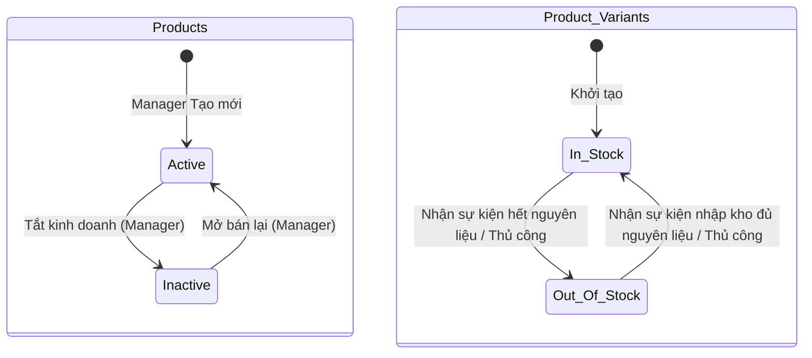
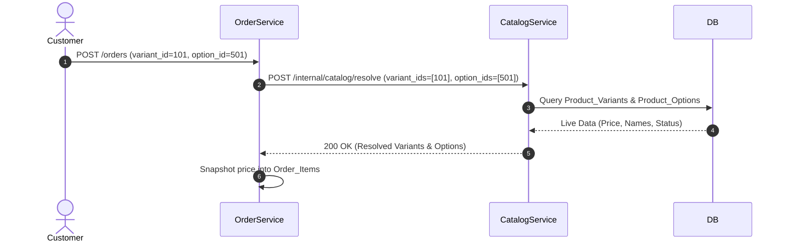

# 02. Catalog Service Specification

## 1. Document Information
- **Service Name:** Catalog Service
- **System:** Smart Café AI System (Microservices Architecture)
- **Database:** `smart_cafe_catalog_db`
- **Port:** `8082`
- **Gateway Prefix:** `/catalog`
- **Version:** 1.0
- **Date:** 28/09/2026

---

## 2. Service Overview
Catalog Service quản lý toàn bộ thực đơn của quán cà phê bao gồm danh mục sản phẩm, danh sách sản phẩm, các biến thể (size, giá bán) và nhóm tùy chọn đính kèm (mức đường, mức đá, topping,...). Catalog Service phục vụ tìm kiếm công khai cho khách hàng và cung cấp API quản trị cho Quản lý/Admin thiết lập menu.

---

## 3. Responsibilities & Scope

### 3.1 Responsibilities
- Quản lý danh mục (Categories) và upload hình ảnh sản phẩm.
- Quản lý thông tin sản phẩm (Products), biến thể (Product_Variants) và giá bán tương ứng.
- Quản lý nhóm tùy chọn (Product_Option_Groups) và các option chi tiết (Product_Options).
- Cung cấp API nội bộ cho Order Service snapshot thông tin giá và tên tại thời điểm đặt hàng.
- Lắng nghe sự kiện biến động tồn kho từ Inventory Service để cập nhật trạng thái `status` của biến thể (`In_Stock` / `Out_Of_Stock`).

### 3.2 In Scope
- Tra cứu danh mục, tìm kiếm và lọc sản phẩm (theo từ khóa, danh mục, khoảng giá).
- Xem chi tiết sản phẩm kèm các biến thể và topping hợp lệ.
- Thêm, sửa, chuyển trạng thái `Active`/`Inactive` của sản phẩm.
- Thiết lập biến thể và tùy chọn sản phẩm.

### 3.3 Out of Scope
- Quản lý nguyên liệu pha chế và công thức (do Inventory Service quản lý).
- Lưu trữ trực tiếp đánh giá sản phẩm (do Engagement Service quản lý; Catalog chỉ hiển thị điểm trung bình `rating_avg`).

---

## 4. Actors
- **Public / Customer:** Xem danh mục, tìm kiếm/lọc sản phẩm, xem chi tiết sản phẩm.
- **Manager / Admin:** CRUD danh mục, sản phẩm, biến thể, giá bán, nhóm tùy chọn. Upload hình ảnh.
- **Order / Cart Service:** Gọi API nội bộ `/internal/catalog/resolve` để validate và snapshot thông tin sản phẩm.
- **Inventory Service:** Gửi sự kiện `VariantAvailabilityChanged` để tự động bật/tắt bán variant.

---

## 5. Business Functions
1. **Tìm kiếm & Hiển thị (Public):**
   - Lấy danh mục sản phẩm (`GET /catalog/categories`).
   - Lọc sản phẩm theo danh mục, tên, khoảng giá, trạng thái tồn kho (`GET /catalog/products`).
   - Xem chi tiết sản phẩm, kích thước (size), giá bán, các nhóm topping (`GET /catalog/products/{id}`).
2. **Quản trị Thực đơn (Manager/Admin):**
   - CRUD danh mục sản phẩm và upload ảnh.
   - Tạo sản phẩm mới kèm các biến thể & option groups trong 1 transaction (`POST /catalog/products`).
   - Cập nhật giá bán biến thể (snapshot giá không làm ảnh hưởng đơn hàng cũ).
   - Đặt trạng thái `In_Stock` / `Out_Of_Stock` thủ công cho biến thể.
3. **Internal API:**
   - Resolve snapshot biến thể và tùy chọn cho Order Service (`POST /internal/catalog/resolve`).

---

## 6. Database Ownership

### 6.1 Database
- **Database Name:** `smart_cafe_catalog_db`
- **Engine:** MySQL 8.0+
- **Charset:** `utf8mb4_unicode_ci`

### 6.2 Owned Tables

#### 1. Table: `Categories`
```sql
CREATE TABLE Categories (
    id INT AUTO_INCREMENT PRIMARY KEY,
    name VARCHAR(100) NOT NULL UNIQUE,
    image VARCHAR(255) NULL
);
```

#### 2. Table: `Products`
```sql
CREATE TABLE Products (
    id INT AUTO_INCREMENT PRIMARY KEY,
    category_id INT NOT NULL,
    name VARCHAR(100) NOT NULL,
    image VARCHAR(255) NULL,
    description TEXT NULL,
    status ENUM('Active', 'Inactive') DEFAULT 'Active',
    created_at DATETIME DEFAULT CURRENT_TIMESTAMP,
    updated_at DATETIME DEFAULT CURRENT_TIMESTAMP ON UPDATE CURRENT_TIMESTAMP,
    CONSTRAINT fk_products_category FOREIGN KEY (category_id) REFERENCES Categories(id)
);
```

#### 3. Table: `Product_Variants`
```sql
CREATE TABLE Product_Variants (
    id INT AUTO_INCREMENT PRIMARY KEY,
    product_id INT NOT NULL,
    variant_name VARCHAR(50) NOT NULL DEFAULT 'Standard',
    price DECIMAL(10, 2) NOT NULL,
    status ENUM('In_Stock', 'Out_Of_Stock') DEFAULT 'In_Stock',
    CONSTRAINT fk_variants_product FOREIGN KEY (product_id) REFERENCES Products(id) ON DELETE CASCADE,
    CONSTRAINT uq_product_variant UNIQUE (product_id, variant_name)
);
```

#### 4. Table: `Product_Option_Groups`
```sql
CREATE TABLE Product_Option_Groups (
    id INT AUTO_INCREMENT PRIMARY KEY,
    product_id INT NOT NULL,
    name VARCHAR(50) NOT NULL,
    selection_type ENUM('Single', 'Multiple') NOT NULL,
    is_required BOOLEAN DEFAULT FALSE,
    CONSTRAINT fk_option_groups_product FOREIGN KEY (product_id) REFERENCES Products(id) ON DELETE CASCADE
);
```

#### 5. Table: `Product_Options`
```sql
CREATE TABLE Product_Options (
    id INT AUTO_INCREMENT PRIMARY KEY,
    group_id INT NOT NULL,
    option_name VARCHAR(100) NOT NULL,
    extra_price DECIMAL(10, 2) DEFAULT 0.00,
    status ENUM('Available', 'Unavailable') DEFAULT 'Available',
    CONSTRAINT fk_options_group FOREIGN KEY (group_id) REFERENCES Product_Option_Groups(id) ON DELETE CASCADE
);
```

### 6.3 External References
- Không có khóa ngoại trực tiếp. `Product_Reviews` bên Engagement Service tham chiếu mềm tới `Products.id`.

---

## 7. Business Rules
- **[BR-CAT-01] Giá bán sản phẩm:** Giá bán `Product_Variants.price` phải > 0. Khi điều chỉnh giá bán, đơn hàng cũ đã đặt giữ nguyên giá đã snapshot trong `Order_Items`.
- **[BR-CAT-02] Xóa sản phẩm:** Sản phẩm đã phát sinh đơn hàng chỉ được đổi `status` thành `Inactive` (Xóa mềm), không xóa cứng để đảm bảo tính toàn vẹn dữ liệu lịch sử.
- **[BR-CAT-03] Nhóm tùy chọn:** `selection_type = 'Single'` buộc khách chỉ được chọn 1 option trong nhóm (ví dụ: Mức đá 50%). `is_required = true` yêu cầu phải chọn ít nhất 1 option khi thêm vào giỏ.
- **[BR-CAT-04] Đồng bộ Tồn kho:** Khi nhận sự kiện `VariantAvailabilityChanged(can_make=false)` từ Inventory Service, Catalog Service lập tức chuyển `Product_Variants.status` tương ứng sang `Out_Of_Stock`.

---

## 8. State / Status Flow

### Product & Variant Status Flow


---

## 9. API Specification

### 9.1 API Summary (24 APIs)
- `GET /catalog/categories` (Public) - Lấy danh mục sản phẩm
- `GET /catalog/products` (Public) - Tìm kiếm & lọc sản phẩm
- `GET /catalog/products/{id}` (Public) - Xem chi tiết sản phẩm kèm size/options
- `POST/PUT/DELETE /catalog/categories` (Manager/Admin) - QL danh mục
- `POST /catalog/images` (Manager/Admin) - Upload ảnh sản phẩm
- `GET /catalog/admin/products` (Manager/Admin) - Lấy danh sách sản phẩm quản trị
- `POST/PUT/PATCH/DELETE /catalog/products` (Manager/Admin) - QL sản phẩm
- `POST/PUT/PATCH/DELETE /catalog/variants` (Manager/Admin) - QL biến thể & giá
- `POST/PUT/DELETE /catalog/option-groups` (Manager/Admin) - QL nhóm tùy chọn
- `POST/PUT/DELETE /catalog/options` (Manager/Admin) - QL tùy chọn chi tiết
- `POST /internal/catalog/resolve` (Internal) - Resolve snapshot thông tin giá & tên

### 9.2 API Details (Ví dụ Tiêu biểu)

#### `GET /catalog/products/{id}`
- **Response 200 OK:**
  ```json
  {
    "success": true,
    "data": {
      "id": 10,
      "category_id": 2,
      "category_name": "Cà Phê Phin",
      "name": "Cà Phê Sữa Đá",
      "image": "https://cdn.smartcafe.vn/images/caphesua.png",
      "description": "Cà phê đậm đà kết hợp sữa đặc ngọt ngào",
      "status": "Active",
      "rating_avg": 4.8,
      "rating_count": 120,
      "variants": [
        { "id": 101, "variant_name": "Size M", "price": 29000, "status": "In_Stock" },
        { "id": 102, "variant_name": "Size L", "price": 35000, "status": "In_Stock" }
      ],
      "option_groups": [
        {
          "id": 201,
          "name": "Mức Đá",
          "selection_type": "Single",
          "is_required": true,
          "options": [
            { "id": 501, "option_name": "100% Đá", "extra_price": 0, "status": "Available" },
            { "id": 502, "option_name": "Ít Đá", "extra_price": 0, "status": "Available" }
          ]
        }
      ]
    }
  }
  ```

---

## 10. Event Specification

### 10.1 Published Events
*(Catalog Service chủ yếu đóng vai trò Read Model cho Client)*

### 10.2 Consumed Events
- **`VariantAvailabilityChanged` (từ Inventory Service):**
  - **Payload:** `{ "branch_id": 1, "variant_id": 101, "can_make": false }`
  - **Action:** Cập nhật `Product_Variants.status = 'Out_Of_Stock'` khi `can_make = false`.

---

## 11. Dependencies & Service Integration
- **Engagement Service:** Gọi API composition hoặc Redis Cache lấy `rating_avg` & `rating_count` gắn vào sản phẩm.
- **Inventory Service:** Tiếp nhận sự kiện biến động khả năng pha chế để cập nhật trạng thái variant.

---

## 12. Error Handling
- `404 NOT_FOUND`: Không tìm thấy sản phẩm hoặc danh mục.
- `409 CONFLICT`: Xóa danh mục khi vẫn còn sản phẩm đính kèm; Xóa biến thể duy nhất của sản phẩm đang Active.
- `422 OUT_OF_STOCK`: Biến thể yêu cầu đã hết hàng.

---

## 13. Security & Authorization
- **Public API:** `GET /catalog/**` công khai không yêu cầu token authentication.
- **Admin API:** Yêu cầu JWT token có vai trò `Manager` hoặc `Admin`.

---

## 14. Sequence Flow



---

## 15. Non-functional Requirements
- **Hiệu năng:** API tra cứu danh mục / sản phẩm công khai phản hồi < 50ms (sử dụng Redis Cache cho danh mục & top sản phẩm).
- **Tính sẵn sàng:** Đáp ứng 99.9% uptime cho luồng duyệt menu.

---

## 16. Open Issues / Decision Log
- **[DECISION-CAT-01]:** Đánh giá sản phẩm (`rating_avg`) được tính toán bất đồng bộ qua sự kiện duyệt review từ Engagement Service để tránh truy vấn join liên DB.
