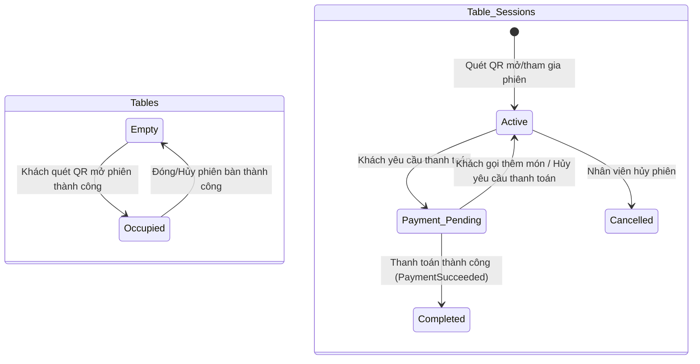
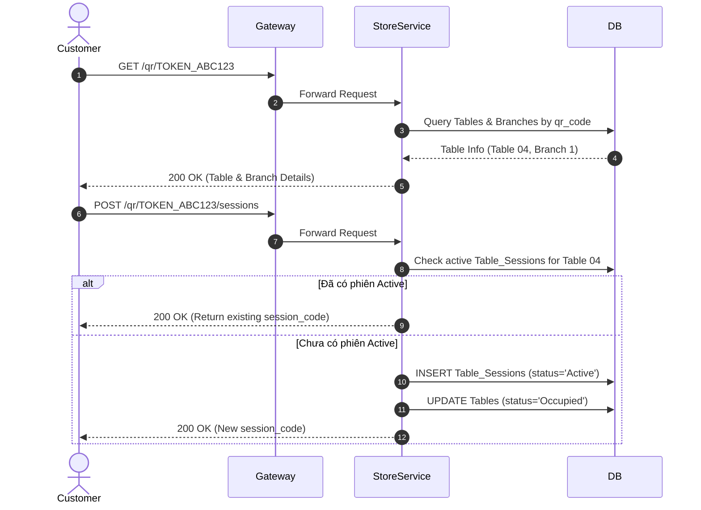

# 03. Store Service Specification

## 1. Document Information
- **Service Name:** Store Service
- **System:** Smart Café AI System (Microservices Architecture)
- **Database:** `smart_cafe_store_db`
- **Port:** `8083`
- **Gateway Prefixes:** `/branches`, `/tables`, `/qr`, `/table-sessions`
- **Version:** 1.0
- **Date:** 28/09/2026

---

## 2. Service Overview
Store Service chịu trách nhiệm quản lý thông tin chi nhánh cửa hàng, sơ đồ bàn ăn tại quán, tạo và quản lý mã QR động cho từng bàn, cũng như quản lý vòng đời phiên làm việc tại bàn (`Table_Sessions`). Đây là service nòng nốt phục vụ luồng gọi món tại quán bằng quét mã QR (QR Ordering).

---

## 3. Responsibilities & Scope

### 3.1 Responsibilities
- Quản lý danh sách chi nhánh cửa hàng (Branches).
- Quản lý vị trí bàn (Tables) và tạo token mã QR duy nhất cho từng bàn.
- Sinh file ảnh QR (PNG/SVG) và xuất file PDF bộ mã QR phục vụ in ấn đặt tại bàn.
- Quản lý phiên bàn (`Table_Sessions`): Mở phiên khi quét QR, ghép nhiều người dùng vào cùng phiên bàn, xử lý trạng thái chờ thanh toán và đóng phiên khi hoàn tất.
- Cung cấp API nội bộ xác thực tính hợp lệ của phiên bàn cho Order Service và Payment Service.

### 3.2 In Scope
- CRUD Chi nhánh cửa hàng và thay đổi trạng thái `Active`/`Inactive`.
- CRUD Bàn và tạo lại (regenerate) mã QR khi bị lộ/hỏng.
- Quét QR lấy thông tin bàn và khởi tạo/tham gia phiên bàn.
- Chuyển trạng thái bàn (`Empty` / `Occupied`) và phiên bàn (`Active` / `Payment_Pending` / `Completed` / `Cancelled`).

### 3.3 Out of Scope
- Quản lý phân công nhân viên làm việc tại chi nhánh (do Workforce Service đảm nhận).
- Lưu trữ lịch sử giao dịch thanh toán của bàn (do Payment Service đảm nhận).

---

## 4. Actors
- **Customer / Guest:** Quét QR mở/tham gia phiên bàn, xem phiên bàn hiện tại, gửi yêu cầu thanh toán tại bàn (`POST /table-sessions/current/request-payment`).
- **Staff / Manager:** Xem sơ đồ bàn, danh sách phiên bàn đang hoạt động, đóng/hủy phiên bàn thủ công.
- **Admin:** Quản lý chi nhánh, quản lý bàn, tạo/xuất mã QR hàng loạt.
- **Order Service & Payment Service:** Gọi API nội bộ `/internal/table-sessions/{id}` để kiểm tra phiên bàn hợp lệ trước khi tạo đơn hoặc tạo giao dịch thanh toán gộp.

---

## 5. Business Functions
1. **Quản lý Chi nhánh (Branches):**
   - Danh sách chi nhánh công khai & chi tiết (`GET /branches`, `GET /branches/{id}`).
   - Thêm, sửa, đổi trạng thái chi nhánh (`POST/PUT/PATCH /branches`).
2. **Quản lý Bàn & Mã QR (Tables & QR):**
   - Danh sách bàn theo chi nhánh (`GET /branches/{branchId}/tables`).
   - Thêm bàn mới (tự động sinh mã `qr_code` ngẫu nhiên duy nhất).
   - Regenerate mã QR, tải ảnh QR (PNG/SVG), xuất file PDF in QR cho toàn chi nhánh.
3. **Quản lý Phiên bàn (Table Sessions - QR Ordering):**
   - Giải mã QR code lấy thông tin bàn (`GET /qr/{qr_code}`).
   - Mở hoặc tham gia phiên bàn đang Active (`POST /qr/{qr_code}/sessions`).
   - Khách gửi yêu cầu thanh toán tại bàn (`Payment_Pending`).
   - Nhân viên xem và đóng/hủy phiên bàn.

---

## 6. Database Ownership

### 6.1 Database
- **Database Name:** `smart_cafe_store_db`
- **Engine:** MySQL 8.0+
- **Charset:** `utf8mb4_unicode_ci`

### 6.2 Owned Tables

#### 1. Table: `Branches`
```sql
CREATE TABLE Branches (
    id INT AUTO_INCREMENT PRIMARY KEY,
    name VARCHAR(100) NOT NULL,
    address VARCHAR(255) NOT NULL,
    phone VARCHAR(20) NULL,
    status ENUM('Active', 'Inactive') DEFAULT 'Active'
);
```

#### 2. Table: `Tables`
```sql
CREATE TABLE Tables (
    id INT AUTO_INCREMENT PRIMARY KEY,
    branch_id INT NOT NULL,
    table_number VARCHAR(20) NOT NULL,
    qr_code VARCHAR(255) NOT NULL UNIQUE,
    status ENUM('Empty', 'Occupied') DEFAULT 'Empty',
    CONSTRAINT fk_tables_branch FOREIGN KEY (branch_id) REFERENCES Branches(id) ON DELETE CASCADE,
    CONSTRAINT uq_branch_table UNIQUE (branch_id, table_number)
);
```

#### 3. Table: `Table_Sessions`
```sql
CREATE TABLE Table_Sessions (
    id BIGINT AUTO_INCREMENT PRIMARY KEY,
    table_id INT NOT NULL,
    session_code VARCHAR(64) NOT NULL UNIQUE,
    customer_id VARCHAR(36) NULL,
    status ENUM('Active', 'Payment_Pending', 'Completed', 'Cancelled') DEFAULT 'Active',
    opened_at DATETIME DEFAULT CURRENT_TIMESTAMP,
    closed_at DATETIME NULL,
    CONSTRAINT fk_sessions_table FOREIGN KEY (table_id) REFERENCES Tables(id) ON DELETE CASCADE
);
```

### 6.3 External References
- `Table_Sessions.customer_id`: Tham chiếu mềm tới `smart_cafe_identity_db.Users.id`.

---

## 7. Business Rules
- **[BR-STO-01] Mã QR duy nhất:** `Tables.qr_code` là một token ngẫu nhiên không thể đoán trước (Guaranteed Secure Token). Khi regenerate mã QR, mã cũ lập tức mất hiệu lực.
- **[BR-STO-02] Mở phiên bàn nhóm:** Nếu một bàn đang có phiên `Table_Sessions.status = 'Active'`, khách hàng tiếp theo quét cùng mã QR tại bàn đó sẽ được ghép chung vào phiên bàn hiện tại thay vì tạo phiên mới.
- **[BR-STO-03] Đóng phiên bàn:** Khi nhận sự kiện thanh toán thành công (`PaymentSucceeded`) từ Payment Service cho toàn bộ các đơn thuộc phiên bàn, Store Service tự động chuyển `Table_Sessions.status = 'Completed'`, ghi nhận `closed_at = NOW()` và giải phóng bàn (`Tables.status = 'Empty'`).
- **[BR-STO-04] Ràng buộc Chi nhánh:** Bàn thuộc về chi nhánh `Inactive` sẽ từ chối mở phiên làm việc mới.

---

## 8. State / Status Flow

### Table & Table Session Status Flow


---

## 9. API Specification

### 9.1 API Summary (21 APIs)
- `GET /branches` (Public) - Lấy danh sách chi nhánh Active
- `GET /branches/{id}` (Public) - Xem chi tiết chi nhánh
- `POST/PUT/PATCH/DELETE /branches` (Admin) - CRUD Chi nhánh
- `GET /branches/{branchId}/tables` (Staff/Admin) - Danh sách bàn theo chi nhánh
- `POST/PUT/DELETE /tables` (Admin) - CRUD Bàn
- `POST /tables/{id}/qr/regenerate` (Admin) - Tạo lại mã QR
- `GET /tables/{id}/qr` (Manager/Admin) - Tải ảnh QR (PNG/SVG)
- `GET /branches/{branchId}/tables/qr-export` (Admin) - Xuất PDF toàn bộ QR chi nhánh
- `GET /qr/{qr_code}` (Public) - Giải mã QR code
- `POST /qr/{qr_code}/sessions` (Public/Guest) - Mở/tham gia phiên bàn
- `GET /table-sessions/current` (Guest - X-Table-Session-Code) - Xem phiên bàn hiện tại
- `POST /table-sessions/current/request-payment` (Guest) - Yêu cầu thanh toán
- `GET/PATCH /table-sessions` (Staff/Manager) - Xem & cập nhật phiên bàn
- `GET /internal/table-sessions/{id}` (Internal) - Check phiên bàn hợp lệ

### 9.2 API Details (Ví dụ Tiêu biểu)

#### `POST /qr/{qr_code}/sessions`
- **Header:** `Authorization: Bearer <token>` (Tùy chọn nếu khách đã đăng nhập)
- **Response 200 OK:**
  ```json
  {
    "success": true,
    "data": {
      "id": 1050,
      "table_id": 12,
      "table_number": "Bàn 04",
      "branch_id": 1,
      "session_code": "SESS-8F9A2B3C",
      "customer_id": "u-1234-5678",
      "status": "Active",
      "opened_at": "2026-09-28T10:15:00+07:00",
      "closed_at": null
    }
  }
  ```

---

## 10. Event Specification

### 10.1 Published Events
*(Store Service phát sự kiện thay đổi trạng thái phiên bàn qua hệ thống Notify internal)*

### 10.2 Consumed Events
- **`PaymentSucceeded` (từ Payment Service):**
  - **Payload:** `{ "table_session_id": 1050, "status": "Success" }`
  - **Action:** Cập nhật `Table_Sessions.status = 'Completed'`, `Tables.status = 'Empty'`.

---

## 11. Dependencies & Service Integration
- **Order Service:** Đọc `table_session_id` qua header `X-Table-Session-Code` để xác thực đơn hàng tại bàn.
- **Payment Service:** Đọc thông tin phiên bàn để hỗ trợ thanh toán gộp cho tất cả các đơn thuộc bàn.

---

## 12. Error Handling
- `404 QR_INVALID`: Mã QR quét không tồn tại hoặc đã bị đổi lại.
- `409 BRANCH_INACTIVE`: Chi nhánh cửa hàng hiện đang đóng cửa.
- `409 SESSION_CLOSED`: Phiên bàn đã bị đóng hoặc hủy trước đó.

---

## 13. Security & Authorization
- **Khách tại bàn (Guest):** Xác thực thông qua mã phiên bàn ở Header `X-Table-Session-Code: SESS-8F9A2B3C`.
- **Nhân viên / Admin:** Xác thực qua JWT Token chuẩn.

---

## 14. Sequence Flow



---

## 15. Non-functional Requirements
- **Khả năng mở rộng:** API giải mã QR `/qr/{qr_code}` chịu tải cao vào giờ cao điểm, thời gian phản hồi < 80ms.
- **Độ tin cậy:** Đảm bảo không xảy ra race condition khi 2 khách cùng quét QR tại 1 bàn cùng lúc (Sử dụng Database Locks khi tạo Session).

---

## 16. Open Issues / Decision Log
- **[DECISION-STO-01]:** Khách hàng vãng lai không cần tài khoản vẫn có thể gọi món tại bàn thông qua `X-Table-Session-Code` được lưu tạm thời trên Frontend Storage.
