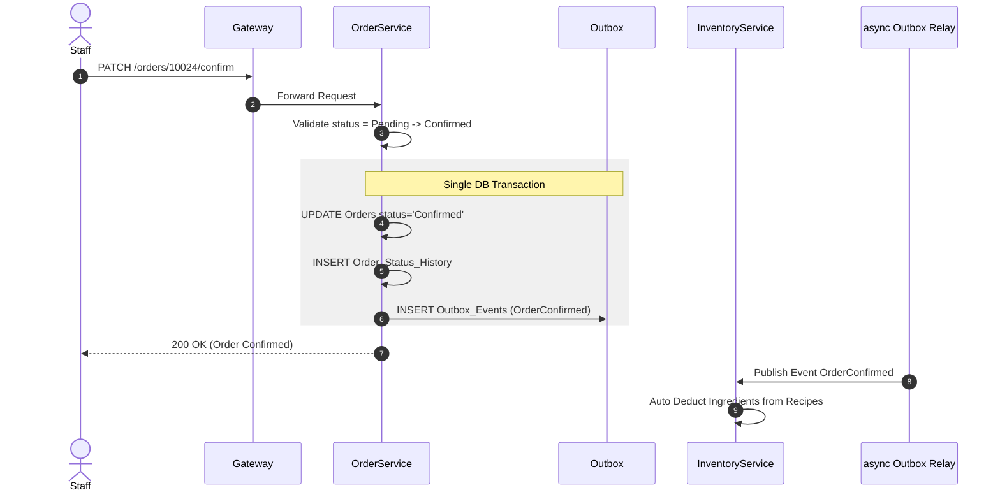

# 04. Order Service Specification

## 1. Document Information
- **Service Name:** Order Service
- **System:** Smart Café AI System (Microservices Architecture)
- **Database:** `smart_cafe_order_db`
- **Port:** `8084`
- **Gateway Prefixes:** `/carts`, `/orders`
- **Version:** 1.0
- **Date:** 28/09/2026

---

## 2. Service Overview
Order Service là dịch vụ cốt lõi quản lý toàn bộ quy trình đặt hàng, giỏ hàng (Cart), vòng đời đơn hàng (Order Lifecycle), lịch sử thay đổi trạng thái và thông báo real-time qua Server-Sent Events (SSE). Order Service áp dụng Transactional Outbox Pattern để phát các sự kiện thay đổi đơn hàng sang Message Broker nhằm phục vụ tự động trừ/hoàn nguyên liệu, tích điểm và thanh toán.

---

## 3. Responsibilities & Scope

### 3.1 Responsibilities
- Quản lý giỏ hàng trực tuyến (Online Cart) và giỏ hàng tại bàn (QR Cart).
- Xử lý tạo đơn hàng từ nhiều nguồn: Online (Delivery/Pickup), QR Ordering (Dine_In), và POS tại quầy.
- Áp dụng Idempotency Key chống đặt trùng lặp đơn hàng.
- Quản lý State Machine toàn bộ vòng đời đơn hàng (`Pending` -> `Confirmed` -> `Preparing` -> `Ready` -> `Shipping`/`Serving` -> `Completed` / `Cancelled` / `Rejected`).
- Ghi nhận lịch sử chuyển trạng thái vào `Order_Status_History`.
- Đẩy sự kiện bất đồng bộ qua `Outbox_Events`.
- Cung cấp kênh truyền dữ liệu thời gian thực Server-Sent Events (`GET /orders/stream`) phục vụ màn hình nhân viên bếp và khách hàng.

### 3.2 In Scope
- Thêm/sửa/xóa dòng sản phẩm trong giỏ hàng.
- Tạo đơn hàng, tính tiền, VAT và snapshot thông tin sản phẩm từ Catalog Service.
- Tiếp nhận, xác nhận, từ chối, cập nhật trạng thái đơn hàng.
- Xử lý hủy đơn và gửi yêu cầu hủy đơn hàng.
- Xuất báo cáo doanh số đơn hàng theo chi nhánh & khoảng thời gian (`GET /orders/reports/sales`).

### 3.3 Out of Scope
- Trừ tồn kho trực tiếp (xử lý bất đồng bộ tại Inventory Service qua sự kiện `OrderConfirmed`).
- Xử lý cổng thanh toán trực tiếp (do Payment Service đảm nhận).
- Quản lý thông tin chi tiết khuyến mãi/tích điểm (do Engagement Service đảm nhận).

---

## 4. Actors
- **Customer:** Quản lý giỏ hàng, đặt đơn Online/QR, xem đơn hàng của tôi, hủy đơn ở trạng thái `Pending`.
- **Guest:** Đặt món tại bàn bằng `X-Table-Session-Code`, xem danh sách đơn hàng thuộc phiên bàn.
- **Staff / Manager:** Nhận đơn, xác nhận/từ chối đơn, cập nhật trạng thái chế biến/phục vụ, tạo đơn POS tại quầy.
- **System / Internal Services:** Đọc thông tin đơn qua `/internal/orders/{id}`, đổi trạng thái đơn tự động qua `/internal/orders/{id}/status`.

---

## 5. Business Functions
1. **Quản lý Giỏ hàng (Carts):**
   - Xem giỏ hàng (`GET /carts/{source}` với source = `online` | `qr`).
   - Thêm/sửa/xóa sản phẩm và option trong giỏ (`POST/PUT/DELETE /carts/{source}/items`).
   - Xóa toàn bộ giỏ (`DELETE /carts/{source}`).
2. **Đặt hàng & Quản lý đơn hàng (Orders):**
   - Tạo đơn hàng mới từ Giỏ hàng hoặc danh sách items trực tiếp (`POST /orders` hỗ trợ Idempotency).
   - Xem lịch sử đơn hàng cá nhân / đơn tại bàn (`GET /orders/me`, `GET /orders/qr`).
   - Khách hủy đơn hoặc gửi yêu cầu hủy (`POST /orders/{id}/cancel`).
3. **Xử lý đơn tại Cửa hàng (POS & Kitchen):**
   - Danh sách đơn hàng theo chi nhánh (`GET /orders`).
   - Xác nhận đơn (`PATCH /orders/{id}/confirm`), Từ chối đơn (`PATCH /orders/{id}/reject`).
   - Cập nhật trạng thái đơn theo luồng (`PATCH /orders/{id}/status`).
   - Nhân viên tạo đơn tại quầy gắn ca thu ngân (`POST /orders/pos`).
   - Duyệt/từ chối yêu cầu hủy đơn từ khách hàng.
4. **Real-time & Reporting:**
   - Kênh SSE cập nhật đơn hàng tức thì (`GET /orders/stream`).
   - Báo cáo doanh số và sản phẩm bán chạy (`GET /orders/reports/sales`, `top-products`).

---

## 6. Database Ownership

### 6.1 Database
- **Database Name:** `smart_cafe_order_db`
- **Engine:** MySQL 8.0+
- **Charset:** `utf8mb4_unicode_ci`

### 6.2 Owned Tables

#### 1. Table: `Orders`
```sql
CREATE TABLE Orders (
    id BIGINT AUTO_INCREMENT PRIMARY KEY,
    order_code VARCHAR(32) NOT NULL UNIQUE,
    user_id VARCHAR(36) NULL,
    branch_id INT NOT NULL,
    table_session_id BIGINT NULL,
    cashier_shift_id INT NULL,
    order_source ENUM('Online', 'QR', 'POS') NOT NULL,
    fulfillment_type ENUM('Delivery', 'Pickup', 'Dine_In') NOT NULL,
    delivery_name VARCHAR(100) NULL,
    delivery_phone VARCHAR(20) NULL,
    delivery_address VARCHAR(255) NULL,
    sub_total DECIMAL(10, 2) NOT NULL,
    vat_amount DECIMAL(10, 2) DEFAULT 0.00,
    final_amount DECIMAL(10, 2) NOT NULL,
    status ENUM('Pending', 'Confirmed', 'Preparing', 'Ready', 'Shipping', 'Completed', 'Cancelled', 'Serving', 'Served', 'Rejected') DEFAULT 'Pending',
    idempotency_key VARCHAR(64) UNIQUE NULL,
    created_at DATETIME DEFAULT CURRENT_TIMESTAMP,
    updated_at DATETIME DEFAULT CURRENT_TIMESTAMP ON UPDATE CURRENT_TIMESTAMP,
    INDEX idx_orders_user (user_id, created_at),
    INDEX idx_orders_branch_status (branch_id, status)
);
```

#### 2. Table: `Order_Items`
```sql
CREATE TABLE Order_Items (
    id BIGINT AUTO_INCREMENT PRIMARY KEY,
    order_id BIGINT NOT NULL,
    product_id INT NOT NULL,
    variant_id INT NOT NULL,
    product_name VARCHAR(100) NOT NULL,
    variant_name VARCHAR(50) NOT NULL,
    quantity INT NOT NULL,
    unit_price DECIMAL(10, 2) NOT NULL,
    note VARCHAR(255) NULL,
    CONSTRAINT fk_order_items_order FOREIGN KEY (order_id) REFERENCES Orders(id) ON DELETE CASCADE
);
```

#### 3. Table: `Order_Item_Options`
```sql
CREATE TABLE Order_Item_Options (
    id BIGINT AUTO_INCREMENT PRIMARY KEY,
    order_item_id BIGINT NOT NULL,
    option_id INT NOT NULL,
    option_name VARCHAR(100) NOT NULL,
    quantity INT DEFAULT 1,
    unit_price DECIMAL(10, 2) NOT NULL,
    CONSTRAINT fk_item_options_item FOREIGN KEY (order_item_id) REFERENCES Order_Items(id) ON DELETE CASCADE
);
```

#### 4. Table: `Order_Status_History`
```sql
CREATE TABLE Order_Status_History (
    id BIGINT AUTO_INCREMENT PRIMARY KEY,
    order_id BIGINT NOT NULL,
    status ENUM('Pending', 'Confirmed', 'Preparing', 'Ready', 'Shipping', 'Completed', 'Cancelled', 'Serving', 'Served', 'Rejected') NOT NULL,
    changed_by VARCHAR(36) NULL,
    note VARCHAR(255) NULL,
    created_at DATETIME DEFAULT CURRENT_TIMESTAMP,
    CONSTRAINT fk_status_history_order FOREIGN KEY (order_id) REFERENCES Orders(id) ON DELETE CASCADE
);
```

#### 5. Table: `Carts`
```sql
CREATE TABLE Carts (
    id BIGINT AUTO_INCREMENT PRIMARY KEY,
    user_id VARCHAR(36) NULL,
    table_session_id BIGINT NULL,
    cart_source ENUM('Online', 'QR') NOT NULL,
    status ENUM('Active', 'Converted', 'Abandoned') DEFAULT 'Active',
    created_at DATETIME DEFAULT CURRENT_TIMESTAMP,
    updated_at DATETIME DEFAULT CURRENT_TIMESTAMP ON UPDATE CURRENT_TIMESTAMP
);
```

#### 6. Table: `Cart_Items` & `Cart_Item_Options`
*(Quản lý sản phẩm lưu tạm trong giỏ trước khi chuyển thành đơn hàng)*

#### 7. Table: `Outbox_Events`
```sql
CREATE TABLE Outbox_Events (
    id BIGINT AUTO_INCREMENT PRIMARY KEY,
    event_id VARCHAR(36) NOT NULL UNIQUE,
    aggregate_type VARCHAR(50) NOT NULL,
    aggregate_id VARCHAR(64) NOT NULL,
    event_type VARCHAR(100) NOT NULL,
    payload JSON NOT NULL,
    status ENUM('Pending', 'Published', 'Failed') DEFAULT 'Pending',
    created_at DATETIME DEFAULT CURRENT_TIMESTAMP,
    published_at DATETIME NULL
);
```

### 6.3 External References
- `Orders.user_id`: Tham chiếu mềm `smart_cafe_identity_db.Users.id`.
- `Orders.table_session_id`: Tham chiếu mềm `smart_cafe_store_db.Table_Sessions.id`.
- `Orders.cashier_shift_id`: Tham chiếu mềm `smart_cafe_payment_db.Cashier_Shifts.id`.

---

## 7. Business Rules
- **[BR-ORD-01] Ràng buộc Nguồn đơn & Phương thức:**
  - `order_source = 'Online'`: Buộc phải có `user_id`, `fulfillment_type` là `Delivery` hoặc `Pickup`.
  - `order_source = 'QR'`: Buộc phải có `table_session_id`, `fulfillment_type = 'Dine_In'`, `user_id` có thể NULL.
  - `order_source = 'POS'`: Nhân viên tạo đơn tại quầy, yêu cầu `cashier_shift_id` phải thuộc ca đang `Open`.
- **[BR-ORD-02] Tính tiền & Snapshot:**
  - Tiền item: `line_total = (unit_price + SUM(option.unit_price * option.quantity)) * quantity`.
  - `sub_total = SUM(line_total)`.
  - `vat_amount = sub_total * (vat.rate / 100)` (Cấu hình VAT mặc định 8.00%).
  - `final_amount = sub_total + vat_amount`.
  - Toàn bộ giá và tên sản phẩm/topping phải được snapshot trực tiếp từ Catalog Service tại thời điểm tạo đơn.
- **[BR-ORD-03] Chống trùng lặp (Idempotency):** Request tạo đơn bắt buộc gửi header `Idempotency-Key`. Nếu trùng key, hệ thống trả lại kết quả đơn hàng đã tạo ban đầu (HTTP 200 OK, header `Idempotent-Replay: true`).
- **[BR-ORD-04] Transactional Outbox:** Mọi thao tác đổi trạng thái đơn làm phát sinh event phải được ghi đồng thời vào bảng `Outbox_Events` cùng database transaction với bảng `Orders`.

---

## 8. State / Status Flow

### State Machine Luồng Trạng Thái Đơn Hàng (`Orders.status`)
```mermaid
stateDiagram-v2
    [*] --> Pending: Tạo đơn mới (Customer / QR / POS)
    Pending --> Confirmed: Nhân viên tiếp nhận (Staff Confirm)
    Pending --> Rejected: Nhân viên từ chối đơn
    Pending --> Cancelled: Khách hủy đơn khi chưa xác nhận
    
    Confirmed --> Preparing: Nhân viên bắt đầu pha chế
    Confirmed --> Cancelled: Hủy đơn có lý do (Duyệt hủy)

    Preparing --> Ready: Pha chế hoàn tất
    
    state Delivery_Flow {
        Ready --> Shipping: Bắt đầu giao hàng (Delivery)
        Shipping --> Completed: Giao hàng thành công
    }

    state Pickup_Flow {
        Ready --> Completed: Khách nhận đồ tại quầy (Pickup)
    }

    state DineIn_Flow {
        Ready --> Serving: Mang đồ ra bàn (Dine_In)
        Serving --> Served: Đã phục vụ tại bàn
        Served --> Completed: Đóng phiên bàn & Thanh toán xong
    }
```

---

## 9. API Specification

### 9.1 API Summary (28 APIs)
- `GET/POST/PUT/DELETE /carts/online` (Customer) - Giỏ hàng online
- `GET/POST/PUT/DELETE /carts/qr` (Guest) - Giỏ hàng tại bàn
- `POST /orders` (Authenticated / Guest) - Tạo đơn hàng (Online/QR)
- `GET /orders/me` (Customer) - Xem danh sách đơn cá nhân
- `GET /orders/me/{id}` (Customer) - Chi tiết đơn cá nhân
- `GET /orders/qr` (Guest) - Danh sách đơn của phiên bàn
- `POST /orders/{id}/cancel` (Customer) - Hủy đơn / Gửi yêu cầu hủy
- `GET /orders` (Staff/Manager) - Quản lý danh sách đơn chi nhánh
- `PATCH /orders/{id}/confirm` (Staff/Manager) - Xác nhận đơn
- `PATCH /orders/{id}/reject` (Staff/Manager) - Từ chối đơn
- `PATCH /orders/{id}/status` (Staff/Manager) - Đổi trạng thái đơn
- `POST /orders/pos` (Staff) - Tạo đơn tại quầy
- `GET /orders/{id}/history` (Staff/Customer) - Xem lịch sử đổi trạng thái
- `GET /orders/stream` (SSE) - Real-time stream sự kiện đơn hàng
- `GET /orders/reports/sales` (Manager/Admin) - Báo cáo doanh số

### 9.2 API Details (Ví dụ Tiêu biểu)

#### `POST /orders`
- **Headers:** `Idempotency-Key: 7b8c9d0e-1234-5678`, `X-Table-Session-Code: SESS-8F9A2B3C` (nếu QR)
- **Request Body:**
  ```json
  {
    "order_source": "Online",
    "fulfillment_type": "Delivery",
    "branch_id": 1,
    "delivery_name": "Nguyen Van A",
    "delivery_phone": "0901234567",
    "delivery_address": "123 Le Loi, Q1, TP.HCM",
    "items": [
      {
        "variant_id": 101,
        "quantity": 2,
        "note": "Ít ngọt",
        "options": [{ "option_id": 501, "quantity": 1 }]
      }
    ]
  }
  ```
- **Response 201 Created:**
  ```json
  {
    "success": true,
    "data": {
      "id": 10024,
      "order_code": "ORD-20260928-10024",
      "order_source": "Online",
      "fulfillment_type": "Delivery",
      "branch_id": 1,
      "sub_total": 58000,
      "vat_amount": 4640,
      "final_amount": 62640,
      "status": "Pending",
      "created_at": "2026-09-28T10:30:00+07:00"
    }
  }
  ```

---

## 10. Event Specification

### 10.1 Published Events (qua Outbox_Events)
- **`OrderCreated`:** Phát khi đơn mới được khởi tạo thành công.
- **`OrderConfirmed`:** Phát khi nhân viên xác nhận đơn (Trigger Inventory Service tự động trừ nguyên liệu).
- **`OrderStatusChanged`:** Phát khi trạng thái đơn thay đổi (Trigger Push Notification/SSE).
- **`OrderCompleted`:** Phát khi đơn hoàn tất (Trigger Engagement Service tích tem cho khách).
- **`OrderCancelled` / `OrderRejected`:** Phát khi đơn bị hủy (Trigger Inventory Service hoàn nguyên liệu và Payment Service refund).

### 10.2 Consumed Events
- **`PaymentSucceeded` (từ Payment Service):** Cập nhật ghi chú "Đã thanh toán" vào lịch sử đơn hàng.

---

## 11. Dependencies & Service Integration
- **Catalog Service:** Gọi đồng bộ `POST /internal/catalog/resolve` để lấy giá & tên chính xác.
- **Inventory Service:** Giao tiếp bất đồng bộ qua sự kiện `OrderConfirmed` để trừ nguyên liệu tồn kho.
- **Payment Service:** Đọc thông tin đơn qua `GET /internal/orders/{id}` để tạo giao dịch thanh toán.

---

## 12. Error Handling
- `400 INVALID_STATE_TRANSITION`: Chuyển trạng thái đơn không đúng quy trình State Machine.
- `409 NO_OPEN_SHIFT`: Tạo đơn POS khi nhân viên chưa mở ca thu ngân.
- `422 OUT_OF_STOCK`: Món ăn/biến thể đã hết hàng tại chi nhánh.

---

## 13. Security & Authorization
- **Customer:** Quyền xem & hủy đơn do mình tạo (`user_id = sub`).
- **Staff / Manager:** Quyền cập nhật trạng thái đơn thuộc `branch_id` phụ trách.

---

## 14. Sequence Flow



---

## 15. Non-functional Requirements
- **Thời gian phản hồi:** API tạo đơn `< 200ms`.
- **Độ tin cậy:** Đảm bảo Idempotency chống đặt lặp khi nghẽn mạng.
- **Real-time SSE:** Đẩy sự kiện đơn mới tới màn hình bếp trong vòng `< 1 giây`.

---

## 16. Open Issues / Decision Log
- **[GAP-ORD-01] Bảng Yêu cầu Hủy đơn:** Hiện tại DB chưa có bảng lưu yêu cầu hủy đơn hàng từ khách sau khi đơn đã Confirmed. Đề xuất DDL bổ sung:
  ```sql
  CREATE TABLE Order_Cancel_Requests (
      id BIGINT AUTO_INCREMENT PRIMARY KEY,
      order_id BIGINT NOT NULL,
      requested_by VARCHAR(36) NOT NULL,
      reason VARCHAR(255) NOT NULL,
      status ENUM('Pending', 'Approved', 'Rejected') DEFAULT 'Pending',
      handled_by VARCHAR(36) NULL,
      created_at DATETIME DEFAULT CURRENT_TIMESTAMP,
      CONSTRAINT fk_cancel_req_order FOREIGN KEY (order_id) REFERENCES Orders(id) ON DELETE CASCADE
  );
  ```
