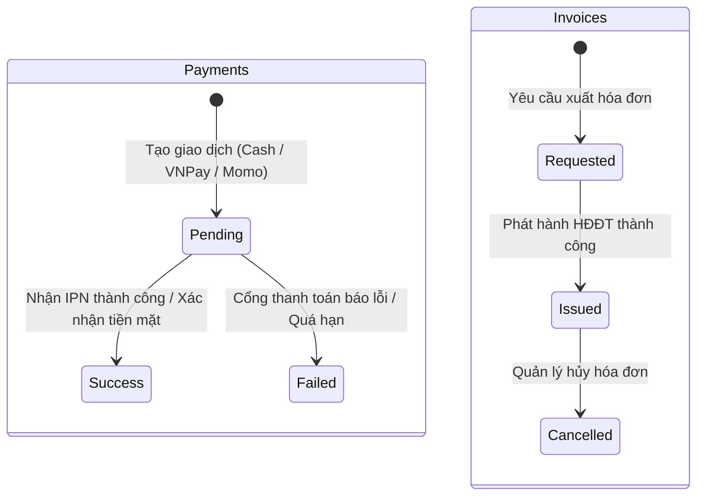
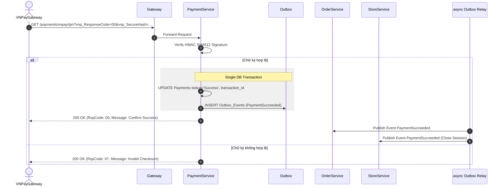

# 05. Payment Service Specification

## 1. Document Information
- **Service Name:** Payment Service
- **System:** Smart Café AI System (Microservices Architecture)
- **Database:** `smart_cafe_payment_db`
- **Port:** `8085`
- **Gateway Prefixes:** `/payments`, `/refunds`, `/invoices`, `/cashier-shifts`
- **Version:** 1.0
- **Date:** 28/09/2026

---

## 2. Service Overview
Payment Service chịu trách nhiệm quản lý toàn bộ các giao dịch thanh toán (Tiền mặt, VNPay, Momo), hoàn tiền (Refunds), phát hành hóa đơn điện tử (Invoices) và quản lý ca làm việc thu ngân (`Cashier_Shifts`). Dịch vụ đảm bảo tính toàn vẹn tài chính, tích hợp cổng thanh toán bên thứ 3 và áp dụng Outbox Pattern để thông báo kết quả thanh toán cho Order và Store Services.

---

## 3. Responsibilities & Scope

### 3.1 Responsibilities
- Xử lý khởi tạo giao dịch thanh toán cho 1 đơn hàng hoặc thanh toán gộp cho cả phiên bàn.
- Tích hợp cổng thanh toán trực tuyến: VNPay, Momo (sinh URL redirect, tiếp nhận & xác thực IPN/Return).
- Xử lý xác nhận thu tiền mặt trực tiếp tại quầy của thu ngân.
- Xử lý yêu cầu và quy trình duyệt hoàn tiền (Refunds).
- Tạo và phát hành hóa đơn điện tử VAT (Invoices) cho đơn hàng.
- Mở/đóng ca thu ngân (`Cashier_Shifts`), tính toán chênh lệch tiền mặt thực tế và doanh số ca.

### 3.2 In Scope
- Tạo và truy vấn trạng thái thanh toán (`Pending`, `Success`, `Failed`).
- Xử lý Webhook / IPN bảo mật (kiểm tra chữ ký số HMAC-SHA512/SHA256).
- Yêu cầu và duyệt xuất hóa đơn PDF.
- Bảng kê đối soát ca thu ngân cuối ca làm việc.

### 3.3 Out of Scope
- Lưu trữ trực tiếp số dư ví tài khoản của khách (Hệ thống không đóng vai trò Ví điện tử).
- Quản lý định giá hay sửa số tiền đơn hàng (Số tiền luôn được lấy từ Order Service).

---

## 4. Actors
- **Customer:** Chọn phương thức thanh toán VNPay/Momo, xem trạng thái giao dịch, yêu cầu xuất hóa đơn điện tử VAT, gửi yêu cầu hoàn tiền.
- **Cashier / Staff:** Xác nhận thu tiền mặt (`POST /payments/{id}/confirm-cash`), mở/đóng ca thu ngân, xuất hóa đơn điện tử trực tiếp tại quầy.
- **Manager:** Duyệt/từ chối yêu cầu hoàn tiền, hủy hóa đơn, xem danh sách ca thu ngân.
- **Third-party Payment Gateway (VNPay/Momo):** Gửi IPN server-to-server cập nhật trạng thái thanh toán.

---

## 5. Business Functions
1. **Thanh toán (Payments):**
   - Tạo giao dịch thanh toán (`POST /payments`).
   - Tiếp nhận callback & IPN (`GET /payments/vnpay/return`, `GET /payments/vnpay/ipn`, `POST /payments/momo/ipn`).
   - Thu ngân xác nhận tiền mặt (`POST /payments/{id}/confirm-cash`).
2. **Hoàn tiền (Refunds):**
   - Gửi yêu cầu hoàn tiền (`POST /refunds`).
   - Nhân viên/Quản lý xử lý duyệt/từ chối hoàn tiền (`POST /refunds/{id}/process`, `POST /refunds/{id}/reject`).
3. **Hóa đơn điện tử (Invoices):**
   - Khách/Nhân viên yêu cầu xuất hóa đơn VAT (`POST /invoices/requests`, `POST /invoices`).
   - Phát hành hóa đơn qua cổng HĐĐT (`POST /invoices/{id}/issue`).
   - Tải file PDF hóa đơn (`GET /invoices/{id}/pdf`).
4. **Quản lý Ca thu ngân (Cashier Shifts):**
   - Thu ngân mở ca (`POST /cashier-shifts/open`).
   - Xem ca hiện tại & doanh số realtime (`GET /cashier-shifts/current`).
   - Thu ngân đóng ca & khai báo tiền mặt (`POST /cashier-shifts/{id}/close`).

---

## 6. Database Ownership

### 6.1 Database
- **Database Name:** `smart_cafe_payment_db`
- **Engine:** MySQL 8.0+
- **Charset:** `utf8mb4_unicode_ci`

### 6.2 Owned Tables

#### 1. Table: `Cashier_Shifts`
```sql
CREATE TABLE Cashier_Shifts (
    id INT AUTO_INCREMENT PRIMARY KEY,
    branch_id INT NOT NULL,
    staff_id VARCHAR(36) NOT NULL,
    opening_time DATETIME NOT NULL,
    closing_time DATETIME NULL,
    opening_cash DECIMAL(10, 2) NOT NULL,
    total_orders INT DEFAULT 0,
    total_cash_sales DECIMAL(10, 2) DEFAULT 0.00,
    total_online_sales DECIMAL(10, 2) DEFAULT 0.00,
    closing_cash DECIMAL(10, 2) NULL,
    discrepancy DECIMAL(10, 2) NULL,
    status ENUM('Open', 'Closed') DEFAULT 'Open'
);
```

#### 2. Table: `Payments`
```sql
CREATE TABLE Payments (
    id BIGINT AUTO_INCREMENT PRIMARY KEY,
    order_id BIGINT NULL,
    table_session_id BIGINT NULL,
    payment_method ENUM('Cash', 'VNPay', 'Momo') NOT NULL,
    amount DECIMAL(10, 2) NOT NULL,
    transaction_id VARCHAR(100) NULL,
    status ENUM('Pending', 'Success', 'Failed') DEFAULT 'Pending',
    idempotency_key VARCHAR(64) UNIQUE NULL,
    created_at DATETIME DEFAULT CURRENT_TIMESTAMP,
    updated_at DATETIME DEFAULT CURRENT_TIMESTAMP ON UPDATE CURRENT_TIMESTAMP,
    CONSTRAINT chk_payment_target CHECK ((order_id IS NOT NULL AND table_session_id IS NULL) OR (order_id IS NULL AND table_session_id IS NOT NULL))
);
```

#### 3. Table: `Refunds`
```sql
CREATE TABLE Refunds (
    id BIGINT AUTO_INCREMENT PRIMARY KEY,
    payment_id BIGINT NOT NULL,
    amount DECIMAL(10, 2) NOT NULL,
    reason TEXT NULL,
    status ENUM('Pending', 'Processed', 'Failed') DEFAULT 'Pending',
    processed_at DATETIME NULL,
    processed_by VARCHAR(36) NULL,
    refund_transaction_id VARCHAR(100) NULL,
    created_at DATETIME DEFAULT CURRENT_TIMESTAMP,
    CONSTRAINT fk_refunds_payment FOREIGN KEY (payment_id) REFERENCES Payments(id)
);
```

#### 4. Table: `Invoices`
```sql
CREATE TABLE Invoices (
    id BIGINT AUTO_INCREMENT PRIMARY KEY,
    order_id BIGINT NOT NULL,
    invoice_number VARCHAR(50) NULL,
    symbol VARCHAR(20) NULL,
    template_code VARCHAR(50) NULL,
    tax_code VARCHAR(20) NOT NULL,
    company_name VARCHAR(255) NOT NULL,
    buyer_address VARCHAR(255) NULL,
    email VARCHAR(100) NULL,
    total_amount DECIMAL(10, 2) NOT NULL,
    vat_rate DECIMAL(5, 2) DEFAULT 8.00,
    vat_amount DECIMAL(10, 2) NOT NULL,
    lookup_code VARCHAR(50) NULL,
    pdf_url VARCHAR(255) NULL,
    status ENUM('Requested', 'Issued', 'Cancelled') DEFAULT 'Requested',
    issued_at DATETIME NULL,
    created_at DATETIME DEFAULT CURRENT_TIMESTAMP,
    CONSTRAINT fk_invoices_order FOREIGN KEY (order_id) REFERENCES Orders(id)
);
```

#### 5. Table: `Outbox_Events`
*(Lưu các sự kiện `PaymentSucceeded`, `PaymentFailed`, `RefundProcessed`, `InvoiceIssued`)*

---

## 7. Business Rules
- **[BR-PAY-01] Ràng buộc Giao dịch:** `Payments` chỉ tham chiếu tới 1 trong 2 đối tượng: `order_id` (Đơn lẻ) HOẶC `table_session_id` (Thanh toán gộp cho cả phiên bàn).
- **[BR-PAY-02] Xác minh Số tiền:** Số tiền `amount` của giao dịch luôn được Server lấy trực tiếp từ Order Service, tuyệt đối không tin tưởng giá trị gửi lên từ Client.
- **[BR-PAY-03] Ca thu ngân:** Mỗi nhân viên tại một thời điểm chỉ được phép mở duy nhất 1 ca `Cashier_Shifts.status = 'Open'`. Khi thu ngân xác nhận giao dịch tiền mặt, doanh số `total_cash_sales` và `total_orders` của ca đó tự động được cộng dồn.
- **[BR-PAY-04] Chênh lệch tiền mặt cuối ca:** Khi đóng ca, `discrepancy = closing_cash - (opening_cash + total_cash_sales)`.

---

## 8. State / Status Flow

### Payment & Invoice Status Flow


---

## 9. API Specification

### 9.1 API Summary (28 APIs)
- `POST /payments` (Customer/Staff) - Tạo thanh toán
- `GET /payments/vnpay/return` (Public) - Callback VNPay
- `GET /payments/vnpay/ipn` (Public) - Webhook IPN VNPay
- `POST /payments/momo/ipn` (Public) - Webhook IPN Momo
- `GET /payments/{id}` (Customer/Staff) - Chi tiết thanh toán
- `POST /payments/{id}/confirm-cash` (Staff) - Xác nhận tiền mặt
- `POST/GET /refunds` (Customer/Staff) - CRUD Hoàn tiền
- `POST /refunds/{id}/process` (Staff/Manager) - Duyệt hoàn tiền
- `POST/GET /invoices` (Customer/Staff) - CRUD Hóa đơn VAT
- `POST /invoices/{id}/issue` (Staff) - Phát hành HĐĐT
- `GET /invoices/{id}/pdf` (Public) - Tải file PDF HĐĐT
- `POST /cashier-shifts/open` (Staff) - Mở ca thu ngân
- `GET /cashier-shifts/current` (Staff) - Ca thu ngân hiện tại
- `POST /cashier-shifts/{id}/close` (Staff) - Đóng ca thu ngân

### 9.2 API Details (Ví dụ Tiêu biểu)

#### `POST /payments`
- **Request Body:**
  ```json
  {
    "order_id": 10024,
    "payment_method": "VNPay",
    "return_url": "https://smartcafe.vn/order/10024/result"
  }
  ```
- **Response 201 Created:**
  ```json
  {
    "success": true,
    "data": {
      "id": 5001,
      "order_id": 10024,
      "payment_method": "VNPay",
      "amount": 62640,
      "status": "Pending",
      "payment_url": "https://sandbox.vnpayment.vn/paymentv2/vpcpay.html?vnp_Amount=6264000&vnp_Command=pay..."
    }
  }
  ```

---

## 10. Event Specification

### 10.1 Published Events (qua Outbox_Events)
- **`PaymentSucceeded`:** Phát khi trạng thái thanh toán chuyển `Success`. Order Service lắng nghe để ghi nhận lịch sử, Store Service lắng nghe để đóng phiên bàn.
- **`PaymentFailed`:** Phát khi giao dịch thất bại.
- **`RefundProcessed`:** Phát khi tiền được hoàn trả thành công về tài khoản khách.

### 10.2 Consumed Events
- **`OrderCancelled` / `OrderRejected` (từ Order Service):** Tự động khởi tạo bản ghi `Refunds` ở trạng thái `Pending` nếu đơn hàng đã được thanh toán thành công trước đó.

---

## 11. Dependencies & Service Integration
- **Order Service:** Gọi `GET /internal/orders/{id}` lấy tổng tiền đơn.
- **Platform Service:** Đọc cấu hình cổng thanh toán (VNPay TMN Code, Hash Secret, Momo Keys) từ `System_Configs`.

---

## 12. Error Handling
- `402 PAYMENT_FAILED`: Giao dịch bị cổng thanh toán từ chối.
- `409 NO_OPEN_SHIFT`: Không thể xác nhận tiền mặt vì nhân viên chưa mở ca thu ngân.
- `409 INVALID_AMOUNT`: Số tiền yêu cầu hoàn vượt quá số tiền đã thu thực tế.

---

## 13. Security & Authorization
- **IPN Security:** Kiểm tra checksum/signature của VNPay (`vnp_SecureHash`) và Momo (`signature`) trước khi xử lý DB.
- **Data Scoping:** Thu ngân chỉ được xác nhận tiền mặt cho các đơn thuộc cùng `branch_id`.

---

## 14. Sequence Flow



---

## 15. Non-functional Requirements
- **An toàn tài chính:** Đảm bảo Idempotency tuyệt đối cho các request IPN (không xử lý lại nếu giao dịch đã ở trạng thái `Success`).
- **Bảo mật dữ liệu:** Secret Keys của các cổng thanh toán phải được mã hóa khi lưu trữ.

---

## 16. Open Issues / Decision Log
- **[GAP-PAY-01] Enum Refund Status:** Enum `Refunds.status` hiện chưa có giá trị `'Rejected'`. Đề xuất DDL sửa đổi:
  ```sql
  ALTER TABLE Refunds MODIFY status ENUM('Pending', 'Processed', 'Failed', 'Rejected') DEFAULT 'Pending';
  ```
