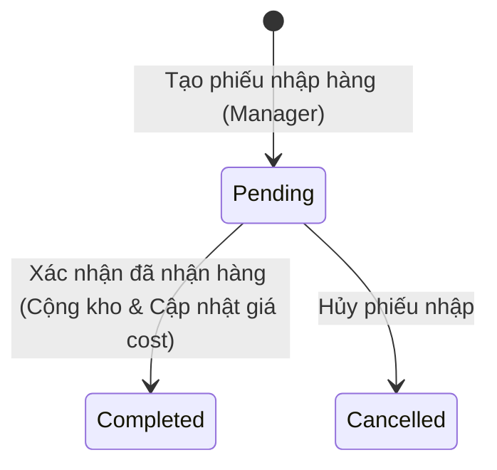
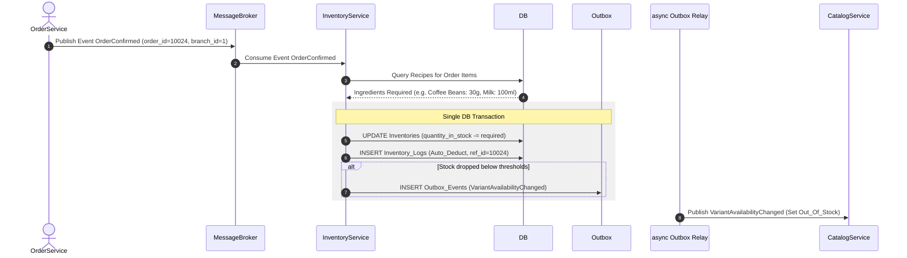

# 06. Inventory Service Specification

## 1. Document Information
- **Service Name:** Inventory Service
- **System:** Smart Café AI System (Microservices Architecture)
- **Database:** `smart_cafe_inventory_db`
- **Port:** `8086`
- **Gateway Prefix:** `/inventory`
- **Version:** 1.0
- **Date:** 28/09/2026

---

## 2. Service Overview
Inventory Service chịu trách nhiệm quản lý kho nguyên liệu (Ingredients) theo từng chi nhánh, định lượng công thức pha chế (Recipes), giá vốn bình quân (Average Cost), nhà cung cấp (Suppliers) và nhập hàng (Purchase Orders). Đặc biệt, service tự động xử lý khấu trừ nguyên liệu khi xác nhận đơn hàng và hoàn lại nguyên liệu khi hủy đơn thông qua kiến trúc hướng sự kiện (Event-Driven Architecture).

---

## 3. Responsibilities & Scope

### 3.1 Responsibilities
- Quản lý danh mục nguyên liệu (g, ml, cái,...) và đơn vị tính.
- Quản lý tồn kho thực tế của từng nguyên liệu tại từng chi nhánh (`Inventories`).
- Quản lý công thức pha chế cho từng biến thể sản phẩm (`Recipes`) và tự động tính toán giá vốn cost.
- Lắng nghe sự kiện `OrderConfirmed` từ Order Service để tự động khấu trừ kho (`Auto_Deduct`).
- Lắng nghe sự kiện `OrderCancelled` / `OrderRejected` để tự động hoàn trả tồn kho (`Refund`).
- Quản lý quy trình nhập hàng từ Nhà cung cấp (`Purchase_Orders` -> `PO_Details`), tính toán lại giá vốn bình quân gia quyền.
- Kiểm tra tính khả thi pha chế cho các đơn hàng (`POST /internal/inventory/availability`).

### 3.2 In Scope
- CRUD Nguyên liệu, Nhà cung cấp, Công thức sản phẩm.
- Kiểm kê kho thủ công (Điều chỉnh `Adjustment` hoặc ghi hao hụt `Waste`).
- Tra cứu nhật ký biến động kho (`Inventory_Logs`).
- Báo cáo chi phí nhập hàng, giá vốn hàng bán (COGS) và tiêu hao nguyên liệu.

### 3.3 Out of Scope
- Định giá bán niêm yết của sản phẩm (do Catalog Service quản lý).
- Thanh toán công nợ nhà cung cấp (thực hiện ở hệ thống kế toán bên ngoài).

---

## 4. Actors
- **Manager:** Quản lý nguyên liệu, công thức pha chế, kiểm kê kho, lập và xác nhận phiếu nhập hàng (PO).
- **Admin:** Xem báo cáo toàn hệ thống, quản lý danh mục nguyên liệu master.
- **Order Service / Cart Service:** Gọi API nội bộ kiểm tra số lượng có thể pha chế.
- **Message Broker:** Đẩy sự kiện đơn hàng để Inventory tiêu thụ bất đồng bộ.

---

## 5. Business Functions
1. **Quản lý Nguyên liệu (Ingredients):**
   - CRUD danh mục nguyên liệu (`GET/POST/PUT/DELETE /inventory/ingredients`).
2. **Quản lý Tồn kho & Nhật ký (Inventories & Logs):**
   - Xem tồn kho theo chi nhánh (`GET /inventory/stocks`).
   - Kiểm kê điều chỉnh tồn kho / Ghi hao hụt (`POST /inventory/stocks/adjustments`).
   - Nhật ký xuất nhập tồn (`GET /inventory/logs`).
3. **Công thức pha chế & Giá Cost (Recipes):**
   - Quản lý định lượng nguyên liệu cho biến thể (`GET/PUT /inventory/recipes/variants/{variantId}`).
   - Xem giá vốn cost của biến thể (`cost_price = SUM(quantity_required * average_cost)`).
4. **Nhà cung cấp & Nhập hàng (Suppliers & Purchase Orders):**
   - CRUD nhà cung cấp (`/inventory/suppliers`).
   - Lập phiếu nhập hàng (`POST /inventory/purchase-orders`).
   - Hoàn tất nhập hàng (`POST /inventory/purchase-orders/{id}/complete`) -> Tự động cộng kho & tính giá vốn mới.
5. **Báo cáo & Internal API:**
   - Báo cáo chi phí và tiêu hao (`GET /inventory/reports/costs`, `usage`).
   - Kiểm tra khả năng pha chế (`POST /internal/inventory/availability`).

---

## 6. Database Ownership

### 6.1 Database
- **Database Name:** `smart_cafe_inventory_db`
- **Engine:** MySQL 8.0+
- **Charset:** `utf8mb4_unicode_ci`

### 6.2 Owned Tables

#### 1. Table: `Ingredients`
```sql
CREATE TABLE Ingredients (
    id INT AUTO_INCREMENT PRIMARY KEY,
    name VARCHAR(100) NOT NULL,
    unit VARCHAR(20) NOT NULL,
    average_cost DECIMAL(10, 2) DEFAULT 0.00,
    CONSTRAINT uq_ingredient_name_unit UNIQUE (name, unit)
);
```

#### 2. Table: `Inventories`
```sql
CREATE TABLE Inventories (
    id BIGINT AUTO_INCREMENT PRIMARY KEY,
    branch_id INT NOT NULL,
    ingredient_id INT NOT NULL,
    quantity_in_stock DECIMAL(10, 3) DEFAULT 0.000,
    CONSTRAINT fk_inventories_ingredient FOREIGN KEY (ingredient_id) REFERENCES Ingredients(id),
    CONSTRAINT uq_branch_ingredient UNIQUE (branch_id, ingredient_id)
);
```

#### 3. Table: `Recipes`
```sql
CREATE TABLE Recipes (
    id BIGINT AUTO_INCREMENT PRIMARY KEY,
    variant_id INT NOT NULL,
    ingredient_id INT NOT NULL,
    quantity_required DECIMAL(10, 3) NOT NULL,
    CONSTRAINT fk_recipes_ingredient FOREIGN KEY (ingredient_id) REFERENCES Ingredients(id),
    CONSTRAINT uq_variant_ingredient UNIQUE (variant_id, ingredient_id)
);
```

#### 4. Table: `Suppliers`
```sql
CREATE TABLE Suppliers (
    id INT AUTO_INCREMENT PRIMARY KEY,
    name VARCHAR(100) NOT NULL,
    phone VARCHAR(20) NULL,
    address VARCHAR(255) NULL
);
```

#### 5. Table: `Purchase_Orders` & `PO_Details`
```sql
CREATE TABLE Purchase_Orders (
    id BIGINT AUTO_INCREMENT PRIMARY KEY,
    branch_id INT NOT NULL,
    supplier_id INT NOT NULL,
    total_amount DECIMAL(10, 2) DEFAULT 0.00,
    status ENUM('Pending', 'Completed', 'Cancelled') DEFAULT 'Pending',
    created_at DATETIME DEFAULT CURRENT_TIMESTAMP,
    CONSTRAINT fk_po_supplier FOREIGN KEY (supplier_id) REFERENCES Suppliers(id)
);

CREATE TABLE PO_Details (
    id BIGINT AUTO_INCREMENT PRIMARY KEY,
    po_id BIGINT NOT NULL,
    ingredient_id INT NOT NULL,
    quantity DECIMAL(10, 3) NOT NULL,
    unit_price DECIMAL(10, 2) NOT NULL,
    CONSTRAINT fk_po_details_po FOREIGN KEY (po_id) REFERENCES Purchase_Orders(id) ON DELETE CASCADE,
    CONSTRAINT fk_po_details_ingredient FOREIGN KEY (ingredient_id) REFERENCES Ingredients(id)
);
```

#### 6. Table: `Inventory_Logs`
```sql
CREATE TABLE Inventory_Logs (
    id BIGINT AUTO_INCREMENT PRIMARY KEY,
    branch_id INT NOT NULL,
    ingredient_id INT NOT NULL,
    transaction_type ENUM('Import', 'Auto_Deduct', 'Refund', 'Waste', 'Adjustment') NOT NULL,
    quantity_changed DECIMAL(10, 3) NOT NULL,
    reference_type VARCHAR(50) NULL,
    reference_id VARCHAR(64) NULL,
    created_at DATETIME DEFAULT CURRENT_TIMESTAMP,
    CONSTRAINT fk_logs_ingredient FOREIGN KEY (ingredient_id) REFERENCES Ingredients(id)
);
```

#### 7. Table: `Outbox_Events`
*(Lưu sự kiện `VariantAvailabilityChanged`, `InventoryDeducted`, `PurchaseOrderCompleted`)*

---

## 7. Business Rules
- **[BR-INV-01] Tự động Trừ/Hoàn Kho theo Đơn hàng:**
  - Khi tiếp nhận `OrderConfirmed`: Với mỗi `variant_id` trong đơn, truy vấn `Recipes` để lấy số lượng nguyên liệu cần thiết. Thực hiện `quantity_in_stock = quantity_in_stock - (quantity_required * order_item_qty)`. Ghi `Inventory_Logs` với `transaction_type = 'Auto_Deduct'`.
  - Khi tiếp nhận `OrderCancelled`: Thực hiện cộng trả nguyên liệu tương ứng và ghi `Inventory_Logs` với `transaction_type = 'Refund'`.
- **[BR-INV-02] Tính Giá Vốn Bình Quân Gia Quyền (Weighted Average Cost):**
  - Khi hoàn tất phiếu nhập hàng (`PO Completed`):
    $$\text{average\_cost}_{\text{mới}} = \frac{(\text{Tồn cũ} \times \text{Cost cũ}) + (\text{Số lượng nhập} \times \text{Đơn giá nhập})}{\text{Tồn cũ} + \text{Số lượng nhập}}$$
- **[BR-INV-03] Không cho phép Tồn âm:** Nếu thao tác trừ kho dẫn tới `quantity_in_stock < 0`, hệ thống ghi nhận cảnh báo và tự động kích hoạt sự kiện phát sang Catalog Service đánh dấu `Product_Variants.status = 'Out_Of_Stock'`.

---

## 8. State / Status Flow

### Purchase Order Status Flow


---

## 9. API Specification

### 9.1 API Summary (28 APIs)
- `GET/POST/PUT/DELETE /inventory/ingredients` (Manager/Admin) - CRUD Nguyên liệu
- `GET /inventory/stocks` (Staff/Manager) - Tra cứu tồn kho
- `POST /inventory/stocks/adjustments` (Manager) - Kiểm kê / Báo hao hụt
- `GET /inventory/logs` (Manager/Admin) - Nhật ký biến động kho
- `GET/PUT /inventory/recipes/variants/{variantId}` (Manager/Admin) - Công thức & giá cost
- `GET/POST/PUT/DELETE /inventory/suppliers` (Manager/Admin) - CRUD Nhà cung cấp
- `GET/POST/PUT/DELETE /inventory/purchase-orders` (Manager) - Quản lý nhập hàng
- `POST /inventory/purchase-orders/{id}/complete` (Manager) - Duyệt hoàn tất nhập hàng
- `GET /inventory/reports/costs` (Manager/Admin) - Báo cáo chi phí
- `POST /internal/inventory/availability` (Internal) - Kiểm tra khả năng pha chế

### 9.2 API Details (Ví dụ Tiêu biểu)

#### `POST /inventory/purchase-orders/{id}/complete`
- **Response 200 OK:**
  ```json
  {
    "success": true,
    "data": {
      "id": 801,
      "branch_id": 1,
      "supplier_id": 3,
      "supplier_name": "Công ty Nông Sản Đà Lạt",
      "total_amount": 5500000,
      "status": "Completed",
      "updated_ingredients": [
        {
          "ingredient_id": 12,
          "name": "Hạt Cà Phê Robusta",
          "quantity_added": 50.000,
          "new_stock": 65.500,
          "new_average_cost": 92000
        }
      ]
    }
  }
  ```

---

## 10. Event Specification

### 10.1 Published Events (qua Outbox_Events)
- **`VariantAvailabilityChanged`:** Phát khi nguyên liệu liên quan đến 1 món bị hết hoặc vừa được bổ sung đủ. Catalog Service nhận event này để đổi trạng thái `In_Stock` / `Out_Of_Stock`.
- **`PurchaseOrderCompleted`:** Phát khi hoàn tất phiếu nhập kho.

### 10.2 Consumed Events
- **`OrderConfirmed` (từ Order Service):**
  - **Payload:** `{ "order_id": 10024, "branch_id": 1, "items": [...] }`
  - **Action:** Trừ kho theo công thức pha chế (`Auto_Deduct`).
- **`OrderCancelled` / `OrderRejected` (từ Order Service):**
  - **Action:** Hoàn lại tồn kho (`Refund`).

---

## 11. Dependencies & Service Integration
- **Catalog Service:** Cung cấp thông tin variant và nhận sự kiện thay đổi khả năng pha chế.
- **Order Service:** Tiếp nhận sự kiện xác nhận/hủy đơn để tự động cập nhật kho.

---

## 12. Error Handling
- `400 INVALID_RECIPE`: Công thức pha chế không hợp lệ hoặc thiếu định lượng nguyên liệu.
- `409 PO_ALREADY_COMPLETED`: Phiên nhập hàng đã hoàn tất trước đó, không thể chỉnh sửa.
- `422 INSUFFICIENT_STOCK`: Tồn kho không đủ để thực hiện điều chỉnh hoặc xuất bán.

---

## 13. Security & Authorization
- **Manager / Admin:** Quyền tạo công thức, lập phiếu nhập hàng, đối soát kiểm kê kho.
- **Staff:** Chỉ có quyền xem số lượng tồn kho thực tế tại chi nhánh của mình.

---

## 14. Sequence Flow



---

## 15. Non-functional Requirements
- **Chính xác dữ liệu:** Đảm bảo không xảy ra sai lệch tồn kho khi nhiều đơn hàng được xác nhận đồng thời (Sử dụng Optimistic/Pessimistic Locking khi update `quantity_in_stock`).
- **Idempotency Event Processing:** Xử lý sự kiện `OrderConfirmed` dựa trên `event_id` duy nhất để tránh trừ kho 2 lần cho 1 đơn hàng.

---

## 16. Open Issues / Decision Log
- **[DECISION-INV-01]:** Căn cứ theo Use Case QL-07 & QL-08, việc trừ/hoàn nguyên liệu được tự động hóa hoàn toàn bằng sự kiện bất đồng bộ, không phát sinh use case màn hình riêng cho nhân viên.
