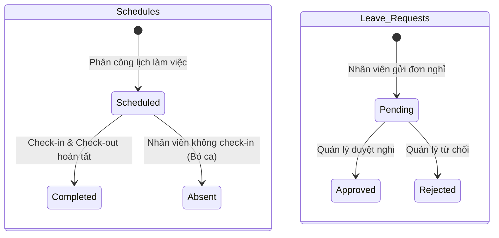
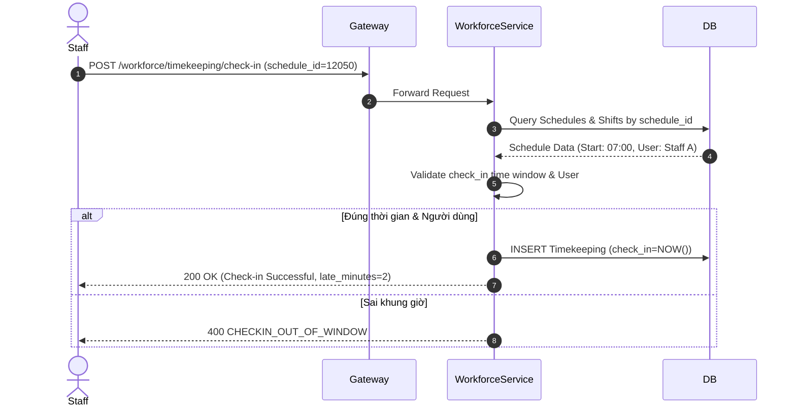

# 07. Workforce Service Specification

## 1. Document Information
- **Service Name:** Workforce Service
- **System:** Smart Café AI System (Microservices Architecture)
- **Database:** `smart_cafe_workforce_db`
- **Port:** `8087`
- **Gateway Prefix:** `/workforce`
- **Version:** 1.0
- **Date:** 28/09/2026

---

## 2. Service Overview
Workforce Service quản lý toàn bộ công tác nhân sự tại các chi nhánh bao gồm: định nghĩa các ca làm việc (Shifts), lập và phân công lịch làm việc (Schedules), ghi nhận chấm công Check-in/Check-out (`Timekeeping`), quản lý đơn xin nghỉ phép (`Leave_Requests`) và xử lý yêu cầu đổi ca làm việc giữa các nhân viên.

---

## 3. Responsibilities & Scope

### 3.1 Responsibilities
- Tạo và định nghĩa khung giờ ca làm việc (Sáng, Chiều, Tối,...).
- Xếp lịch làm việc theo tuần/tháng cho nhân viên chi nhánh (hỗ trợ phân công hàng loạt).
- Ghi nhận thời gian Check-in/Check-out chấm công thực tế của nhân viên.
- Tính toán số phút đi muộn (`late_minutes`) và thời gian làm việc thực tế (`worked_minutes`).
- Quản lý đơn xin nghỉ phép và quy trình duyệt của Quản lý.
- Quản lý yêu cầu đổi ca làm việc giữa các nhân viên và quy trình duyệt hoán đổi lịch.

### 3.2 In Scope
- CRUD Khung ca làm việc (`Shifts`).
- Phân công lịch làm việc đơn lẻ và hàng loạt (`Schedules`).
- Nhân viên thực hiện Check-in / Check-out ca làm việc.
- Nhân viên gửi đơn xin nghỉ phép / gửi yêu cầu đổi ca.
- Quản lý duyệt nghỉ phép và duyệt đổi ca.

### 3.3 Out of Scope
- Tính lương chi tiết (Payroll) và các khoản giảm trừ thuế (thực hiện ở hệ thống HR bên ngoài).
- Quản lý ca thu ngân đóng/mở tiền mặt (do Payment Service quản lý).

---

## 4. Actors
- **Staff:** Xem lịch làm việc của mình (`GET /workforce/schedules/me`), thực hiện Check-in/Check-out, xem lịch sử chấm công, gửi đơn xin nghỉ phép, gửi yêu cầu đổi ca.
- **Manager:** Định nghĩa ca làm việc, xếp lịch làm việc chi nhánh, duyệt/từ chối đơn nghỉ phép, duyệt/từ chối yêu cầu đổi ca, xem bảng chấm công toàn chi nhánh.
- **Admin:** Quản lý khung ca làm việc và lịch làm việc trên toàn hệ thống.

---

## 5. Business Functions
1. **Ca làm việc (Shifts):**
   - CRUD định nghĩa ca làm việc (`GET/POST/PUT/DELETE /workforce/shifts`).
2. **Lịch làm việc (Schedules):**
   - Tra cứu lịch làm việc chi nhánh (`GET /workforce/schedules`).
   - Xếp lịch đơn lẻ / xếp lịch hàng loạt (`POST /workforce/schedules`, `POST /workforce/schedules/bulk`).
   - Nhân viên xem lịch làm việc và nhiệm vụ (SOP) (`GET /workforce/schedules/me`).
3. **Chấm công (Timekeeping):**
   - Check-in vào ca (`POST /workforce/timekeeping/check-in`).
   - Check-out kết thúc ca (`POST /workforce/timekeeping/check-out`).
   - Xem bảng chấm công cá nhân & toàn chi nhánh.
4. **Nghỉ phép & Đổi ca (Leave & Shift Swap):**
   - Gửi đơn xin nghỉ phép & Quản lý duyệt nghỉ phép (`/workforce/leave-requests`).
   - Gửi yêu cầu đổi ca & Quản lý duyệt đổi ca (`/workforce/shift-swap-requests`).

---

## 6. Database Ownership

### 6.1 Database
- **Database Name:** `smart_cafe_workforce_db`
- **Engine:** MySQL 8.0+
- **Charset:** `utf8mb4_unicode_ci`

### 6.2 Owned Tables

#### 1. Table: `Shifts`
```sql
CREATE TABLE Shifts (
    id INT AUTO_INCREMENT PRIMARY KEY,
    branch_id INT NOT NULL,
    name VARCHAR(50) NOT NULL,
    start_time TIME NOT NULL,
    end_time TIME NOT NULL,
    CONSTRAINT uq_branch_shift_name UNIQUE (branch_id, name)
);
```

#### 2. Table: `Schedules`
```sql
CREATE TABLE Schedules (
    id BIGINT AUTO_INCREMENT PRIMARY KEY,
    user_id VARCHAR(36) NOT NULL,
    shift_id INT NOT NULL,
    work_date DATE NOT NULL,
    status ENUM('Scheduled', 'Completed', 'Absent') DEFAULT 'Scheduled',
    created_at DATETIME DEFAULT CURRENT_TIMESTAMP,
    CONSTRAINT fk_schedules_shift FOREIGN KEY (shift_id) REFERENCES Shifts(id) ON DELETE CASCADE,
    CONSTRAINT uq_user_shift_date UNIQUE (user_id, shift_id, work_date)
);
```

#### 3. Table: `Timekeeping`
```sql
CREATE TABLE Timekeeping (
    id BIGINT AUTO_INCREMENT PRIMARY KEY,
    schedule_id BIGINT NOT NULL UNIQUE,
    check_in DATETIME NOT NULL,
    check_out DATETIME NULL,
    CONSTRAINT fk_timekeeping_schedule FOREIGN KEY (schedule_id) REFERENCES Schedules(id) ON DELETE CASCADE
);
```

#### 4. Table: `Leave_Requests`
```sql
CREATE TABLE Leave_Requests (
    id BIGINT AUTO_INCREMENT PRIMARY KEY,
    user_id VARCHAR(36) NOT NULL,
    start_date DATE NOT NULL,
    end_date DATE NOT NULL,
    reason TEXT NOT NULL,
    status ENUM('Pending', 'Approved', 'Rejected') DEFAULT 'Pending',
    approver_id VARCHAR(36) NULL,
    created_at DATETIME DEFAULT CURRENT_TIMESTAMP,
    INDEX idx_leave_user_status (user_id, status)
);
```

#### 5. Table: `Shift_Swap_Requests` *(Đề xuất DDL mới)*
```sql
CREATE TABLE Shift_Swap_Requests (
    id BIGINT AUTO_INCREMENT PRIMARY KEY,
    requester_id VARCHAR(36) NOT NULL,
    from_schedule_id BIGINT NOT NULL,
    to_user_id VARCHAR(36) NULL,
    to_schedule_id BIGINT NULL,
    reason TEXT NOT NULL,
    status ENUM('Pending', 'Approved', 'Rejected') DEFAULT 'Pending',
    approver_id VARCHAR(36) NULL,
    created_at DATETIME DEFAULT CURRENT_TIMESTAMP,
    CONSTRAINT fk_swap_from FOREIGN KEY (from_schedule_id) REFERENCES Schedules(id),
    INDEX idx_swap_requester (requester_id, status)
);
```

### 6.3 External References
- `Schedules.user_id`, `Leave_Requests.user_id`, `approver_id`: Tham chiếu mềm tới `smart_cafe_identity_db.Users.id`.
- `Shifts.branch_id`: Tham chiếu mềm tới `smart_cafe_store_db.Branches.id`.

---

## 7. Business Rules
- **[BR-WF-01] Quy tắc Check-in:** Nhân viên chỉ được phép Check-in trong cửa sổ thời gian cấu hình trước ca (ví dụ: tối đa 30 phút trước `start_time` ca làm việc và không muộn quá kết thúc ca).
- **[BR-WF-02] Hoàn tất ca làm việc:** Khi nhân viên thực hiện Check-out, hệ thống tự động tính `worked_minutes` và chuyển `Schedules.status` từ `Scheduled` -> `Completed`.
- **[BR-WF-03] Duyệt Nghỉ phép:** Đơn nghỉ phép khi được duyệt (`status = 'Approved'`) sẽ tự động đánh dấu hủy hoặc chuyển trạng thái các lịch làm việc (`Schedules`) của nhân viên trong khoảng thời gian nghỉ.
- **[BR-WF-04] Hoán đổi ca (Shift Swap):** Khi Quản lý phê duyệt `Shift_Swap_Requests`, hệ thống lập tức hoán đổi `user_id` giữa 2 bản ghi `Schedules` tương ứng trong cùng 1 transaction.

---

## 8. State / Status Flow

### Schedule & Request Status Flow


---

## 9. API Specification

### 9.1 API Summary (26 APIs)
- `GET/POST/PUT/DELETE /workforce/shifts` (Manager/Admin) - CRUD Khung ca
- `GET/POST/PUT/DELETE /workforce/schedules` (Manager) - Xếp lịch làm việc
- `POST /workforce/schedules/bulk` (Manager) - Xếp lịch hàng loạt
- `GET /workforce/schedules/me` (Staff) - Xem lịch làm việc cá nhân
- `POST /workforce/timekeeping/check-in` (Staff) - Check-in ca
- `POST /workforce/timekeeping/check-out` (Staff) - Check-out ca
- `GET /workforce/timekeeping/me` (Staff) - Xem lịch sử chấm công
- `POST/GET/DELETE /workforce/leave-requests` (Staff) - Đơn xin nghỉ phép
- `PATCH /workforce/leave-requests/{id}/approve` (Manager) - Duyệt nghỉ phép
- `PATCH /workforce/leave-requests/{id}/reject` (Manager) - Từ chối nghỉ phép
- `POST/GET /workforce/shift-swap-requests` (Staff) - Yêu cầu đổi ca
- `PATCH /workforce/shift-swap-requests/{id}/approve` (Manager) - Duyệt đổi ca

### 9.2 API Details (Ví dụ Tiêu biểu)

#### `POST /workforce/timekeeping/check-in`
- **Request Body:**
  ```json
  {
    "schedule_id": 12050
  }
  ```
- **Response 200 OK:**
  ```json
  {
    "success": true,
    "data": {
      "id": 9001,
      "schedule_id": 12050,
      "check_in": "2026-09-28T07:02:15+07:00",
      "check_out": null,
      "late_minutes": 2
    }
  }
  ```

---

## 10. Event Specification

### 10.1 Published Events
*(Workforce phát các sự kiện cập nhật lịch phục vụ phân công nhiệm vụ)*

### 10.2 Consumed Events
- Lắng nghe sự kiện tài khoản bị khóa (`UserBanned`) từ Identity Service để tự động hủy các lịch làm việc tương lai.

---

## 11. Dependencies & Service Integration
- **Identity Service:** Gọi `/internal/users/batch` để hiển thị tên và avatar nhân viên trong bảng xếp lịch làm việc.
- **Intelligence Service:** Nhận tài liệu SOP quy trình nghiệp vụ để đính kèm vào phần nhiệm vụ làm việc của nhân viên (`GET /workforce/schedules/me`).

---

## 12. Error Handling
- `400 CHECKIN_TOO_EARLY / TOO_LATE`: Check-in ngoài khung giờ cho phép.
- `409 ALREADY_CHECKED_IN`: Ca làm việc đã được Check-in trước đó.
- `409 SCHEDULE_CONFLICT`: Nhân viên đã có lịch làm việc khác trùng khung giờ.

---

## 13. Security & Authorization
- **Staff:** Chỉ xem được lịch và thực hiện chấm công cho chính tài khoản của mình (`user_id = sub`).
- **Manager:** Lập lịch và phê duyệt đơn từ thuộc phạm vi `branch_id` quản lý.

---

## 14. Sequence Flow



---

## 15. Non-functional Requirements
- **Chính xác thời gian:** Đồng bộ thời gian Server chấm công qua NTP Protocol (chênh lệch < 100ms).
- **Trải nghiệm người dùng:** API Check-in/Check-out phản lưu vết tức thì trên ứng dụng di động của nhân viên.

---

## 16. Open Issues / Decision Log
- **[GAP-WF-01] Bảng Đổi ca làm việc:** Căn cứ theo Use Case NV-09 & QL-04, DB hiện chưa có bảng `Shift_Swap_Requests`. Đề xuất DDL tạo bảng đã được định nghĩa tại Mục 6.2.
