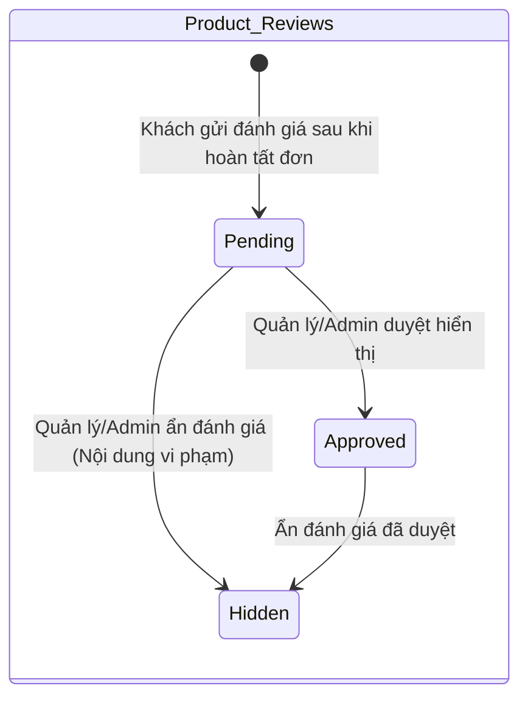
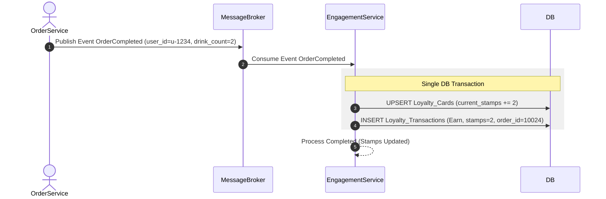

# 08. Engagement Service Specification

## 1. Document Information
- **Service Name:** Engagement Service
- **System:** Smart Café AI System (Microservices Architecture)
- **Database:** `smart_cafe_engagement_db`
- **Port:** `8088`
- **Gateway Prefixes:** `/loyalty`, `/reviews`
- **Version:** 1.0
- **Date:** 28/09/2026

---

## 2. Service Overview
Engagement Service quản lý chương trình khách hàng thân thiết (Loyalty Program) với cơ chế tích tem "Tích 10 ly đổi 1 ly miễn phí" và quản lý đánh giá, nhận xét sản phẩm (Product Reviews) từ khách hàng. Service giúp gia tăng độ gắn kết khách hàng thông qua việc tự động thưởng tem khi đơn hàng hoàn thành và cho phép đổi tem lấy voucher ly nước free.

---

## 3. Responsibilities & Scope

### 3.1 Responsibilities
- Quản lý thẻ tích điểm/tem của khách hàng (`Loyalty_Cards`).
- Tự động cộng tem khi nhận sự kiện `OrderCompleted` từ Order Service.
- Ghi nhận lịch sử giao dịch tem (`Loyalty_Transactions` với loại `Earn`, `Redeem`, `Adjustment`).
- Cung cấp API nội bộ cho Order Service khấu trừ tem khi khách dùng ly miễn phí (`POST /internal/loyalty/redeem`).
- Quản lý đánh giá sản phẩm (Product Reviews) và quy trình kiểm duyệt nội dung của Quản lý/Admin.

### 3.2 In Scope
- Xem thông tin thẻ tem cá nhân và lịch sử tích/đổi tem.
- Điều chỉnh tem thủ công cho khách hàng (Manager/Admin bù tem khi có sự cố).
- Khách hàng gửi đánh giá cho sản phẩm đã mua (sao rating từ 1-5 và comment).
- Duyệt hoặc ẩn đánh giá sản phẩm.

### 3.3 Out of Scope
- Quản lý mã giảm giá voucher khuyến mãi theo giá trị tiền (có thể mở rộng sau).
- Phát hành trực tiếp phần quà hiện vật ngoài đồ uống.

---

## 4. Actors
- **Customer:** Xem thẻ tích ly, xem lịch sử tem, đổi 1 ly nước miễn phí khi đủ 10 tem, gửi đánh giá sản phẩm sau khi đơn hoàn thành.
- **Manager / Admin:** Điều chỉnh tem thủ công cho khách, duyệt/ẩn các đánh giá sản phẩm.
- **Order Service:** Gọi API nội bộ `/internal/loyalty/redeem` để trừ tem khi khách chọn đổi ly miễn phí trên đơn hàng.

---

## 5. Business Functions
1. **Chương trình Tích ly (Loyalty Program):**
   - Xem thẻ tích ly cá nhân (`GET /loyalty/me`).
   - Tra cứu lịch sử tích/đổi tem (`GET /loyalty/me/transactions`).
   - Điều chỉnh tem thủ công (`POST /loyalty/adjustments`).
   - API nội bộ trừ tem đổi ly miễn phí (`POST /internal/loyalty/redeem`).
2. **Đánh giá Sản phẩm (Product Reviews):**
   - Khách hàng gửi đánh giá sản phẩm (`POST /reviews`).
   - Xem danh sách đánh giá sản phẩm công khai (`GET /reviews`).
   - Quản lý duyệt hoặc ẩn đánh giá (`PATCH /reviews/{id}/status`).

---

## 6. Database Ownership

### 6.1 Database
- **Database Name:** `smart_cafe_engagement_db`
- **Engine:** MySQL 8.0+
- **Charset:** `utf8mb4_unicode_ci`

### 6.2 Owned Tables

#### 1. Table: `Loyalty_Cards`
```sql
CREATE TABLE Loyalty_Cards (
    id BIGINT AUTO_INCREMENT PRIMARY KEY,
    user_id VARCHAR(36) NOT NULL UNIQUE,
    current_stamps INT DEFAULT 0,
    total_free_cups INT DEFAULT 0,
    updated_at DATETIME DEFAULT CURRENT_TIMESTAMP ON UPDATE CURRENT_TIMESTAMP
);
```

#### 2. Table: `Loyalty_Transactions`
```sql
CREATE TABLE Loyalty_Transactions (
    id BIGINT AUTO_INCREMENT PRIMARY KEY,
    user_id VARCHAR(36) NOT NULL,
    order_id BIGINT NULL,
    transaction_type ENUM('Earn', 'Redeem', 'Adjustment') NOT NULL,
    stamps INT NOT NULL,
    note VARCHAR(255) NULL,
    created_at DATETIME DEFAULT CURRENT_TIMESTAMP,
    INDEX idx_loyalty_tx_user (user_id, created_at)
);
```

#### 3. Table: `Product_Reviews`
```sql
CREATE TABLE Product_Reviews (
    id BIGINT AUTO_INCREMENT PRIMARY KEY,
    product_id INT NOT NULL,
    user_id VARCHAR(36) NOT NULL,
    order_item_id BIGINT NOT NULL UNIQUE,
    rating INT NOT NULL CHECK (rating BETWEEN 1 AND 5),
    comment TEXT NULL,
    status ENUM('Pending', 'Approved', 'Hidden') DEFAULT 'Pending',
    created_at DATETIME DEFAULT CURRENT_TIMESTAMP,
    INDEX idx_reviews_product_status (product_id, status)
);
```

#### 4. Table: `Outbox_Events`
*(Lưu các sự kiện `LoyaltyStampEarned`, `FreeCupRedeemed`, `ReviewSubmitted`, `ReviewStatusChanged`)*

---

## 7. Business Rules
- **[BR-ENG-01] Quy tắc Tích Tem:** Khi nhận sự kiện `OrderCompleted`, Engagement Service tự động cộng số tem tương ứng với tổng số ly nước trong đơn hàng vào `current_stamps` của khách (`stamps_per_cup = 1`).
- **[BR-ENG-02] Quy tắc Đổi Ly Miễn Phí:** Khách hàng sở hữu `current_stamps >= 10` mới có quyền sử dụng tính năng đổi 1 ly nước miễn phí (`redeem_free_cup = true` trên đơn hàng). Khi đổi, `current_stamps = current_stamps - 10` và `total_free_cups = total_free_cups + 1`.
- **[BR-ENG-03] Đánh giá Sản phẩm hợp lệ:** Khách hàng chỉ có quyền gửi đánh giá cho sản phẩm nếu `order_item_id` thuộc về đơn hàng đã `Completed` của chính khách hàng đó. Mỗi `order_item_id` chỉ được đánh giá duy nhất 1 lần.
- **[BR-ENG-04] Duyệt Đánh giá:** Đánh giá mới tạo mặc định ở trạng thái `Pending`. Chỉ các đánh giá có trạng thái `Approved` mới được hiển thị công khai trên ứng dụng.

---

## 8. State / Status Flow

### Review Status Flow


---

## 9. API Specification

### 9.1 API Summary (9 APIs)
- `GET /loyalty/me` (Customer) - Xem thẻ tích tem cá nhân
- `GET /loyalty/me/transactions` (Customer) - Xem lịch sử tích/đổi tem
- `POST /loyalty/adjustments` (Manager/Admin) - Điều chỉnh tem thủ công
- `POST /internal/loyalty/redeem` (Internal) - Trừ tem đổi ly miễn phí
- `POST /reviews` (Customer) - Gửi đánh giá sản phẩm
- `GET /reviews` (Public) - Xem danh sách đánh giá sản phẩm đã duyệt
- `GET /reviews/me` (Customer) - xem đánh giá của tôi
- `GET /reviews/admin` (Manager/Admin) - Danh sách đánh giá cần kiểm duyệt
- `PATCH /reviews/{id}/status` (Manager/Admin) - Duyệt/ẩn đánh giá

### 9.2 API Details (Ví dụ Tiêu biểu)

#### `GET /loyalty/me`
- **Response 200 OK:**
  ```json
  {
    "success": true,
    "data": {
      "id": 102,
      "user_id": "u-1234-5678",
      "current_stamps": 14,
      "total_free_cups": 2,
      "stamps_required": 10,
      "redeemable_cups": 1,
      "updated_at": "2026-09-28T11:00:00+07:00"
    }
  }
  ```

---

## 10. Event Specification

### 10.1 Published Events (qua Outbox_Events)
- **`LoyaltyStampEarned`:** Phát khi khách hàng tích thêm tem thành công.
- **`FreeCupRedeemed`:** Phát khi khách hàng dùng tem đổi thành công ly miễn phí.
- **`ReviewStatusChanged`:** Phát khi đánh giá sản phẩm được duyệt (Catalog Service nhận event để cập nhật `rating_avg`).

### 10.2 Consumed Events
- **`OrderCompleted` (từ Order Service):**
  - **Payload:** `{ "order_id": 10024, "user_id": "u-1234-5678", "drink_count": 3 }`
  - **Action:** Cộng 3 tem vào `Loyalty_Cards` và ghi `Loyalty_Transactions` loại `Earn`.
- **`OrderCancelled` (từ Order Service):**
  - **Action:** Hoàn trả 10 tem nếu đơn hàng bị hủy có sử dụng tính năng đổi ly miễn phí.

---

## 11. Dependencies & Service Integration
- **Order Service:** Lắng nghe sự kiện `OrderCompleted` để tích tem và nhận lệnh đổi ly miễn phí từ `/internal/loyalty/redeem`.
- **Catalog Service:** Gửi sự kiện cập nhật điểm đánh giá trung bình `rating_avg` của sản phẩm.

---

## 12. Error Handling
- `400 INSUFFICIENT_STAMPS`: Không đủ 10 tem để thực hiện đổi ly miễn phí.
- `409 REVIEW_ALREADY_EXISTS`: Đơn hàng / Sản phẩm này đã được đánh giá trước đó.

---

## 13. Security & Authorization
- **Customer:** Đọc/ghi thông tin thẻ tem và gửi đánh giá cho chính tài khoản của mình (`user_id = sub`).
- **Manager / Admin:** Quyền điều chỉnh tem thủ công và phê duyệt nhận xét.

---

## 14. Sequence Flow



---

## 15. Non-functional Requirements
- **Khả năng mở rộng:** Xử lý sự kiện tích tem bất đồng bộ đảm bảo không làm tăng độ trễ (latency) của luồng hoàn tất đơn hàng.

---

## 16. Open Issues / Decision Log
- **[DECISION-ENG-01]:** Tạo lười (Lazy Creation) cho `Loyalty_Cards` - Thẻ tích điểm tự động được khởi tạo ở lần đầu tiên khách hàng hoàn thành đơn hàng hoặc truy cập xem thẻ tem.
