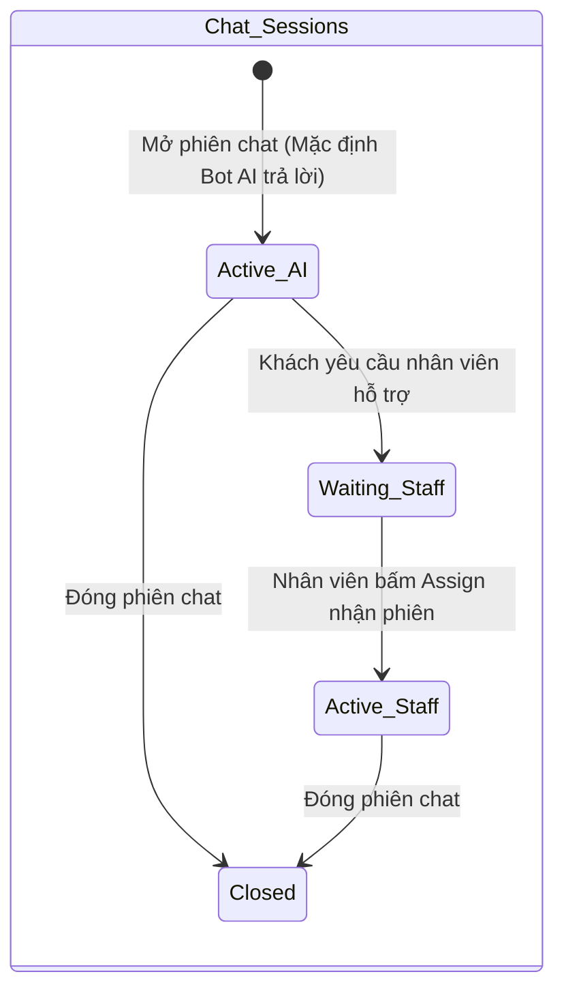
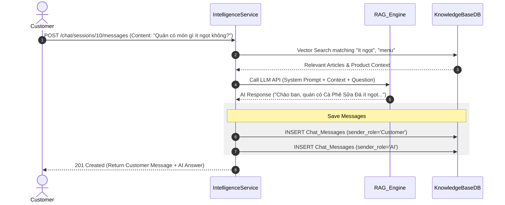

# 09. Intelligence Service Specification

## 1. Document Information
- **Service Name:** Intelligence Service
- **System:** Smart Café AI System (Microservices Architecture)
- **Database:** `smart_cafe_intelligence_db`
- **Port:** `8089`
- **Gateway Prefixes:** `/chat`, `/ws/chat`, `/ai`
- **Version:** 1.0
- **Date:** 28/09/2026

---

## 2. Service Overview
Intelligence Service là trung tâm trí tuệ nhân tạo (AI Engine) của hệ thống Smart Café AI. Dịch vụ cung cấp 4 trụ cột chức năng chính: Trợ lý Chatbot AI tư vấn & hỗ trợ khách hàng (tích hợp RAG - Retrieval-Augmented Generation), chuyển tiếp cuộc hội thoại cho nhân viên tư vấn (`Staff Handoff`), dự báo doanh số & nhu cầu tồn kho (Revenue & Inventory Forecasting) và gợi ý sản phẩm cá nhân hóa (AI Product Recommendations).

---

## 3. Responsibilities & Scope

### 3.1 Responsibilities
- Quản lý phiên chat (`Chat_Sessions`) và lịch sử tin nhắn (`Chat_Messages`) giữa Khách hàng - Chatbot AI - Nhân viên tư vấn.
- Tích hợp giao thức WebSocket (`GET /ws/chat`) phục vụ nhắn tin real-time.
- Quản lý Cơ sở tri thức (`Knowledge_Base` gồm FAQ, SOP nhân viên, Chính sách cửa hàng, Cẩm nang menu) phục vụ kỹ thuật RAG.
- Chạy các mô hình học máy (Machine Learning / Deep Learning) dự báo doanh thu và gợi ý số lượng nguyên liệu cần nhập cho N ngày tới.
- Gợi ý sản phẩm cá nhân hóa cho khách hàng (Cross-Sell, Up-Sell, Trending, Personalized).

### 3.2 In Scope
- Chatbot AI trả lời tự động câu hỏi của khách hàng dựa trên dữ liệu tri thức và thực đơn cửa hàng.
- Chuyển tiếp phiên chat sang cho nhân viên hỗ trợ khi AI không trả lời được hoặc khách yêu cầu.
- Quản lý và indexing cơ sở tri thức cho vector search.
- Sinh và lưu bản ghi dự báo doanh thu / gợi ý nhập kho (`AI_Forecasts`).
- Ghi nhận lượt tương tác click/mua sản phẩm từ gợi ý AI (`AI_Recommendations`).

### 3.3 Out of Scope
- Trực tiếp lưu trữ dữ liệu đơn hàng hay hóa đơn gốc (chỉ đọc dữ liệu thống kê từ Order/Inventory Service để làm dữ liệu huấn luyện/dự báo).

---

## 4. Actors
- **Customer / Guest:** Chat trực tiếp với AI / Nhân viên tư vấn, nhận gợi ý sản phẩm cá nhân hóa trên ứng dụng.
- **Staff:** Nhận phiên chat chuyển tiếp từ khách (`assigned`), phản hồi tin nhắn khách hàng real-time.
- **Manager / Admin:** Quản lý cơ sở tri thức Knowledge Base, kích hoạt và xem kết quả dự báo doanh thu & tồn kho AI.

---

## 5. Business Functions
1. **Chat tư vấn AI & WebSocket Realtime:**
   - Khởi tạo phiên chat (`POST /chat/sessions`).
   - Gửi/Nhận tin nhắn & AI tự động hồi đáp RAG (`POST /chat/sessions/{id}/messages`).
   - Khách yêu cầu hỗ trợ từ nhân viên (`POST /chat/sessions/{id}/request-staff`).
   - Nhân viên nhận phiên chat (`PATCH /chat/sessions/{id}/assign`).
   - Kết nối WebSocket realtime (`GET /ws/chat`).
2. **Cơ sở tri thức (Knowledge Base):**
   - CRUD bài viết tri thức FAQ, SOP nhân viên, Chính sách, Menu guide (`/ai/knowledge-base`).
3. **Dự báo bằng AI (AI Forecasting):**
   - Xem dự báo doanh thu (`GET /ai/forecasts`).
   - Kích hoạt chạy mô hình dự báo doanh thu & tồn kho cho N ngày (`POST /ai/forecasts/generate`).
   - Xem gợi ý số lượng nguyên liệu cần nhập kho (`GET /ai/forecasts/inventory`).
4. **Gợi ý Sản phẩm (AI Recommendations):**
   - Lấy danh sách sản phẩm gợi ý cá nhân hóa (`GET /ai/recommendations/me`).
   - Ghi nhận lượt click vào gợi ý (`POST /ai/recommendations/{id}/click`).

---

## 6. Database Ownership

### 6.1 Database
- **Database Name:** `smart_cafe_intelligence_db`
- **Engine:** MySQL 8.0+
- **Charset:** `utf8mb4_unicode_ci`

### 6.2 Owned Tables

#### 1. Table: `Chat_Sessions`
```sql
CREATE TABLE Chat_Sessions (
    id BIGINT AUTO_INCREMENT PRIMARY KEY,
    user_id VARCHAR(36) NULL,
    staff_id VARCHAR(36) NULL,
    guest_key VARCHAR(64) NULL,
    status ENUM('Active', 'Closed') DEFAULT 'Active',
    created_at DATETIME DEFAULT CURRENT_TIMESTAMP,
    closed_at DATETIME NULL
);
```

#### 2. Table: `Chat_Messages`
```sql
CREATE TABLE Chat_Messages (
    id BIGINT AUTO_INCREMENT PRIMARY KEY,
    session_id BIGINT NOT NULL,
    sender_role ENUM('Customer', 'AI', 'Staff') NOT NULL,
    content TEXT NOT NULL,
    created_at DATETIME DEFAULT CURRENT_TIMESTAMP,
    CONSTRAINT fk_messages_session FOREIGN KEY (session_id) REFERENCES Chat_Sessions(id) ON DELETE CASCADE
);
```

#### 3. Table: `Knowledge_Base`
```sql
CREATE TABLE Knowledge_Base (
    id BIGINT AUTO_INCREMENT PRIMARY KEY,
    category ENUM('FAQ', 'SOP_Staff', 'Policy', 'Menu_Guide') NOT NULL,
    title VARCHAR(255) NOT NULL,
    content TEXT NOT NULL,
    keywords VARCHAR(255) NULL,
    status ENUM('Active', 'Hidden') DEFAULT 'Active',
    created_at DATETIME DEFAULT CURRENT_TIMESTAMP,
    updated_at DATETIME DEFAULT CURRENT_TIMESTAMP ON UPDATE CURRENT_TIMESTAMP
);
```

#### 4. Table: `AI_Forecasts`
```sql
CREATE TABLE AI_Forecasts (
    id BIGINT AUTO_INCREMENT PRIMARY KEY,
    branch_id INT NOT NULL,
    forecast_date DATE NOT NULL,
    predicted_revenue DECIMAL(12, 2) NOT NULL,
    raw_data JSON NULL,
    created_at DATETIME DEFAULT CURRENT_TIMESTAMP,
    CONSTRAINT uq_branch_forecast_date UNIQUE (branch_id, forecast_date)
);
```

#### 5. Table: `AI_Recommendations`
```sql
CREATE TABLE AI_Recommendations (
    id BIGINT AUTO_INCREMENT PRIMARY KEY,
    user_id VARCHAR(36) NOT NULL,
    product_id INT NOT NULL,
    recommendation_type ENUM('Cross_Sell', 'Up_Sell', 'Personalized', 'Trending') NOT NULL,
    confidence_score DECIMAL(5, 4) NOT NULL,
    reason VARCHAR(255) NULL,
    is_clicked BOOLEAN DEFAULT FALSE,
    is_purchased BOOLEAN DEFAULT FALSE,
    created_at DATETIME DEFAULT CURRENT_TIMESTAMP
);
```

### 6.3 External References
- `Chat_Sessions.user_id`, `staff_id`, `AI_Recommendations.user_id`: Tham chiếu mềm tới `smart_cafe_identity_db.Users.id`.
- `AI_Recommendations.product_id`: Tham chiếu mềm tới `smart_cafe_catalog_db.Products.id`.
- `AI_Forecasts.branch_id`: Tham chiếu mềm tới `smart_cafe_store_db.Branches.id`.

---

## 7. Business Rules
- **[BR-INT-01] Quy trình Chatbot AI RAG:** Khi khách hàng gửi tin nhắn vào phiên chat (`sender_role = 'Customer'`), nếu phiên đó chưa được gán cho nhân viên (`staff_id IS NULL`), hệ thống tự động gọi LLM Engine tra cứu `Knowledge_Base` và `Products` để sinh phản hồi tự động (`sender_role = 'AI'`).
- **[BR-INT-02] Chuyển tiếp Nhân viên (Staff Handoff):** Khi khách bấm yêu cầu nhân viên hỗ trợ hoặc Bot AI không thể trả lời, hệ thống đánh dấu phiên chờ và gửi thông báo tới danh sách nhân viên trực ca (`GET /chat/sessions?assigned=unassigned`). Khi nhân viên bấm `assign`, mọi tin nhắn tiếp theo của nhân viên sẽ có `sender_role = 'Staff'`.
- **[BR-INT-03] Chạy Dự báo AI:** API `POST /ai/forecasts/generate` sẽ thu thập lịch sử bán hàng 90 ngày gần nhất từ Order Service (`/orders/reports/sales`) và Inventory Service (`/inventory/reports/usage`) để tính toán doanh thu dự báo và lưu dữ liệu nhu cầu nguyên liệu vào trường `raw_data.inventory`.

---

## 8. State / Status Flow

### Chat Session & Handoff Flow


---

## 9. API Specification

### 9.1 API Summary (20 APIs)
- `POST/GET /chat/sessions` (Customer/Guest/Staff) - Tạo & Xem phiên chat
- `GET/POST /chat/sessions/{id}/messages` (Authenticated) - Gửi & xem tin nhắn
- `POST /chat/sessions/{id}/request-staff` (Customer) - Yêu cầu chuyển nhân viên
- `PATCH /chat/sessions/{id}/assign` (Staff) - Nhân viên nhận phiên chat
- `POST /chat/sessions/{id}/close` (Customer/Staff) - Đóng phiên chat
- `GET /ws/chat` (WebSocket) - Kênh kết nối nhắn tin realtime
- `GET/POST/PUT/DELETE /ai/knowledge-base` (Manager/Admin) - QL Tri thức RAG
- `GET/POST /ai/forecasts` (Manager/Admin) - Xem & Chạy dự báo AI
- `GET /ai/forecasts/inventory` (Manager/Admin) - Dự báo nhu cầu nguyên liệu
- `GET /ai/recommendations/me` (Customer) - Xem gợi ý món cá nhân hóa
- `POST /ai/recommendations/{id}/click` (Customer) - Ghi nhận click gợi ý

### 9.2 API Details (Ví dụ Tiêu biểu)

#### `POST /ai/forecasts/generate`
- **Request Body:**
  ```json
  {
    "branch_id": 1,
    "horizon_days": 7,
    "include_inventory": true
  }
  ```
- **Response 200 OK:**
  ```json
  {
    "success": true,
    "data": [
      {
        "id": 501,
        "branch_id": 1,
        "forecast_date": "2026-09-29",
        "predicted_revenue": 15200000,
        "created_at": "2026-09-28T12:00:00+07:00"
      }
    ]
  }
  ```

---

## 10. Event Specification

### 10.1 Published Events
- Intelligence Service phát tin nhắn mới qua giao thức WebSocket và Push Notification.

### 10.2 Consumed Events
- **`OrderCompleted` (từ Order Service):** Cập nhật `AI_Recommendations.is_purchased = true` cho các gợi ý khách hàng đã xem và mua thành công.

---

## 11. Dependencies & Service Integration
- **Order Service & Inventory Service:** Thu thập lịch sử bán hàng & tiêu hao nguyên liệu làm tập dữ liệu đầu vào cho AI Model.
- **Platform Service:** Đọc cấu hình AI Model (API Keys, Provider, Model Name) từ `System_Configs`.

---

## 12. Error Handling
- `400 AI_PROVIDER_ERROR`: Lỗi kết nối tới mô hình AI (LLM / Forecast Model).
- `409 CHAT_ALREADY_ASSIGNED`: Phiên chat đã được nhân viên khác tiếp nhận.

---

## 13. Security & Authorization
- **Khách vãng lai (Guest):** Xác thực thông qua header `guest_key` (UUID do Client tự sinh).
- **Nhân viên / Manager / Admin:** Xác thực JWT Token tiêu chuẩn.

---

## 14. Sequence Flow



---

## 15. Non-functional Requirements
- **Thời gian phản hồi RAG:** Phản hồi từ Chatbot AI `< 1.5 giây`.
- **WebSocket Streaming:** Đáp ứng > 500 kết nối đồng thời trên mỗi Instance.

---

## 16. Open Issues / Decision Log
- **[GAP-INT-01] Cột Handoff Chat:** Cần bổ sung cột `handoff_requested` vào `Chat_Sessions` để tối ưu truy vấn danh sách phiên chờ nhân viên:
  ```sql
  ALTER TABLE Chat_Sessions ADD COLUMN handoff_requested BOOLEAN NOT NULL DEFAULT FALSE, ADD INDEX idx_chat_handoff (handoff_requested, status);
  ```
