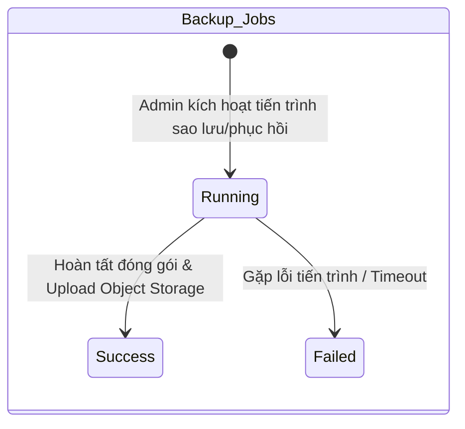
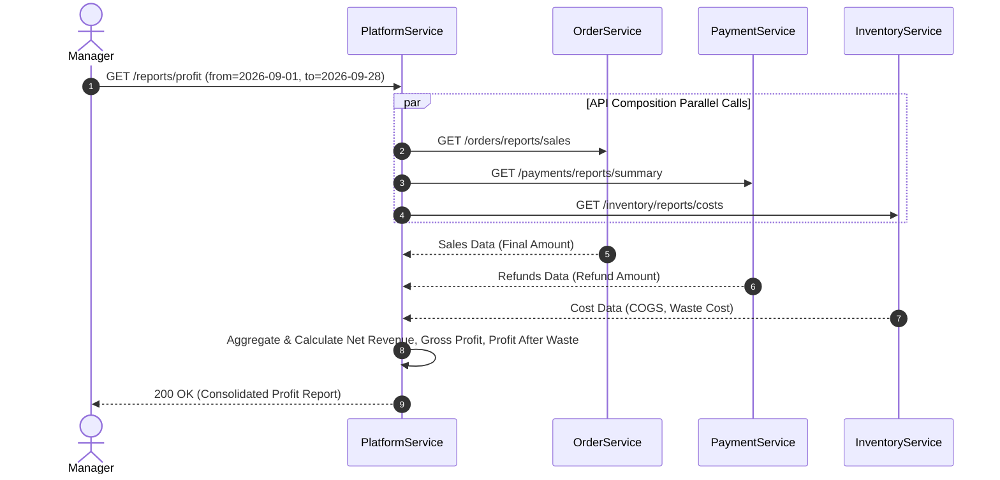

# 10. Platform Service Specification

## 1. Document Information
- **Service Name:** Platform Service
- **System:** Smart Café AI System (Microservices Architecture)
- **Database:** `smart_cafe_platform_db`
- **Port:** `8090`
- **Gateway Prefixes:** `/admin/configs`, `/admin/integrations`, `/admin/audit-logs`, `/admin/backups`, `/reports`, `/configs`
- **Version:** 1.0
- **Date:** 28/09/2026

---

## 2. Service Overview
Platform Service là dịch vụ nền tảng chịu trách nhiệm quản lý cấu hình hệ thống toàn cục (`System_Configs`), quản lý nhật ký truy vết hệ thống (`System_Logs` - Audit Trail), kiểm tra kết nối các dịch vụ tích hợp bên thứ 3 (Payment Gateways, OTP, AI, HĐĐT), thực hiện sao lưu/phục hồi dữ liệu (Backup & Restore) và tổng hợp báo cáo quản trị tổng thể (Báo cáo Doanh thu, Chi phí, Lợi nhuận) thông qua kỹ thuật API Composition.

---

## 3. Responsibilities & Scope

### 3.1 Responsibilities
- Quản lý tập trung các thông số cấu hình hệ thống (Tỷ lệ VAT, quy tắc tích tem, timeout đơn hàng, thông số OTP, secret keys,...).
- Cung cấp API đọc cấu hình công khai Whitelist cho ứng dụng Client (`GET /configs/public`).
- Lưu trữ và truy vấn tập trung nhật ký thao tác và đăng nhập (`System_Logs`).
- Thực hiện kiểm tra trạng thái hoạt động (Health-check) các dịch vụ tích hợp.
- Quản lý tiến trình sao lưu và phục hồi cơ sở dữ liệu (Backup & Restore Jobs).
- Đóng vai trò Báo cáo tổng hợp (API Gateway Aggregator / API Composition): Ghép dữ liệu từ Order, Payment, Inventory Services để xuất báo cáo Doanh thu - Chi phí - Lợi nhuận.

### 3.2 In Scope
- Đọc/ghi thông số cấu hình `System_Configs` (mã hóa các trường nhạy cảm).
- Tra cứu và xuất file nhật ký Audit Log (`GET /admin/audit-logs`, `/export`).
- Kích hoạt tiến trình sao lưu DB (`POST /admin/backups`) và phục hồi DB (`POST /admin/backups/{id}/restore`).
- Tổng hợp Dashboard tổng quan (`GET /reports/overview`), báo cáo Doanh thu (`/reports/revenue`), Chi phí (`/reports/expenses`), Lợi nhuận (`/reports/profit`) và xuất file Excel/PDF (`/reports/export`).

### 3.3 Out of Scope
- Lưu trữ giao dịch nghiệp vụ gốc của các service khác (Platform chỉ truy vấn tổng hợp hoặc nhận log).

---

## 4. Actors
- **Public / Customer:** Đọc các cấu hình công khai (`GET /configs/public`).
- **Admin:** Quản trị toàn bộ cấu hình hệ thống, kiểm tra tích hợp, xem và xuất Audit Logs, kích hoạt sao lưu/phục hồi DB, xem báo cáo tổng hợp.
- **Manager:** Xem các báo cáo kinh doanh tổng hợp (Doanh thu, Lợi nhuận, Sản phẩm bán chạy).
- **Internal Services:** Gửi log thao tác qua API ghi log nội bộ (`POST /internal/logs`).

---

## 5. Business Functions
1. **Cấu hình Hệ thống & Tích hợp (System Configs & Integrations):**
   - Lấy cấu hình công khai cho Frontend (`GET /configs/public`).
   - Admin danh sách & cập nhật cấu hình hệ thống (`/admin/configs`).
   - Trạng thái các tích hợp & kiểm tra kết nối (`GET /admin/integrations`, `POST /admin/integrations/{type}/test`).
2. **Nhật ký Truy vết (Audit Logs):**
   - Tra cứu nhật ký truy cập & chỉnh sửa toàn hệ thống (`GET /admin/audit-logs`).
   - Xuất nhật ký ra file Excel/CSV/PDF (`GET /admin/audit-logs/export`).
   - API ghi log nội bộ cho các service khác (`POST /internal/logs`).
3. **Sao lưu & Phục hồi (Backup & Restore):**
   - Kích hoạt tiến trình sao lưu dữ liệu (`POST /admin/backups`).
   - Danh sách & trạng thái bản sao lưu (`GET /admin/backups`).
   - Phục hồi dữ liệu từ bản sao lưu (`POST /admin/backups/{id}/restore`).
4. **Báo cáo Thống kê Tổng hợp (API Composition Reports):**
   - Dashboard tổng quan kinh doanh (`GET /reports/overview`).
   - Báo cáo Doanh thu, Chi phí, Lợi nhuận (`GET /reports/revenue`, `expenses`, `profit`).
   - Báo cáo hiệu quả kinh doanh theo sản phẩm (`GET /reports/products`).
   - Xuất báo cáo quản trị ra file Excel/PDF (`GET /reports/export`).

---

## 6. Database Ownership

### 6.1 Database
- **Database Name:** `smart_cafe_platform_db`
- **Engine:** MySQL 8.0+
- **Charset:** `utf8mb4_unicode_ci`

### 6.2 Owned Tables

#### 1. Table: `System_Configs`
```sql
CREATE TABLE System_Configs (
    key_name VARCHAR(100) PRIMARY KEY,
    value TEXT NOT NULL,
    updated_at DATETIME DEFAULT CURRENT_TIMESTAMP ON UPDATE CURRENT_TIMESTAMP
);
```

#### 2. Table: `System_Logs`
```sql
CREATE TABLE System_Logs (
    id BIGINT AUTO_INCREMENT PRIMARY KEY,
    user_id VARCHAR(36) NULL,
    source_service VARCHAR(100) NOT NULL,
    trace_id VARCHAR(64) NULL,
    action VARCHAR(100) NOT NULL,
    entity VARCHAR(50) NULL,
    entity_id VARCHAR(64) NULL,
    details TEXT NULL,
    created_at DATETIME DEFAULT CURRENT_TIMESTAMP,
    INDEX idx_logs_service_date (source_service, created_at),
    INDEX idx_logs_user (user_id, created_at),
    INDEX idx_logs_trace (trace_id)
);
```

#### 3. Table: `Backup_Jobs` *(Đề xuất DDL mới)*
```sql
CREATE TABLE Backup_Jobs (
    id VARCHAR(36) PRIMARY KEY,
    job_type ENUM('Backup', 'Restore') NOT NULL,
    scope VARCHAR(100) NOT NULL,
    file_path VARCHAR(255) NULL,
    size_bytes BIGINT DEFAULT 0,
    status ENUM('Running', 'Success', 'Failed') DEFAULT 'Running',
    created_by VARCHAR(36) NOT NULL,
    created_at DATETIME DEFAULT CURRENT_TIMESTAMP,
    finished_at DATETIME NULL
);
```

#### 4. Table: `Expenses` *(Đề xuất DDL mới)*
```sql
CREATE TABLE Expenses (
    id BIGINT AUTO_INCREMENT PRIMARY KEY,
    branch_id INT NOT NULL,
    category VARCHAR(50) NOT NULL,
    amount DECIMAL(12, 2) NOT NULL,
    expense_date DATE NOT NULL,
    note VARCHAR(255) NULL,
    created_by VARCHAR(36) NOT NULL,
    created_at DATETIME DEFAULT CURRENT_TIMESTAMP,
    INDEX idx_expenses_branch_date (branch_id, expense_date)
);
```

### 6.3 External References
- `System_Logs.user_id`, `created_by`: Tham chiếu mềm tới `smart_cafe_identity_db.Users.id`.
- `Expenses.branch_id`: Tham chiếu mềm tới `smart_cafe_store_db.Branches.id`.

---

## 7. Business Rules
- **[BR-PLA-01] Mã hóa Secret Key:** Các cấu hình chứa thông tin nhạy cảm (API Keys, Client Secret, Private Key) bắt buộc phải được mã hóa trước khi lưu vào `System_Configs.value`. Khi trả về qua API Admin, các giá trị này tự động được mask dạng `****`.
- **[BR-PLA-02] Ghi Log Bất đồng bộ (Async Audit Logging):** API `POST /internal/logs` được xử lý qua hàng đợi phi tín hiệu (Non-blocking queue) để việc ghi log của các dịch vụ khác không ảnh hưởng tới thời gian phản hồi của luồng nghiệp vụ chính.
- **[BR-PLA-03] Tính toán Lợi nhuận (Profit Calculation):**
  - $\text{Net Revenue} = \text{Final Amount} - \text{Refund Amount}$
  - $\text{Gross Profit} = \text{Net Revenue} - \text{VAT Amount} - \text{COGS}$
  - $\text{Profit After Waste} = \text{Gross Profit} - \text{Waste Cost}$
- **[BR-PLA-04] An toàn Sao lưu/Phục hồi:** Phao tác Phục hồi dữ liệu (`/admin/backups/{id}/restore`) là thao tác cực kỳ nguy hiểm, yêu cầu Admin xác thực lại mật khẩu hiện tại và tự động đưa hệ thống vào chế độ Bảo trì (Maintenance Mode).

---

## 8. State / Status Flow

### Backup Job Status Flow


---

## 9. API Specification

### 9.1 API Summary (21 APIs)
- `GET /configs/public` (Public) - Lấy cấu hình công khai
- `GET/PUT /admin/configs` (Admin) - Tra cứu & Cập nhật cấu hình
- `GET /admin/integrations` (Admin) - Trạng thái các tích hợp
- `POST /admin/integrations/{type}/test` (Admin) - Test kết nối tích hợp
- `GET /admin/audit-logs` (Admin) - Tra cứu nhật ký truy vết
- `GET /admin/audit-logs/export` (Admin) - Xuất file nhật ký
- `POST /internal/logs` (Internal) - Ghi nhận log từ các service
- `POST/GET /admin/backups` (Admin) - Kích hoạt & Xem danh sách sao lưu
- `POST /admin/backups/{id}/restore` (Admin) - Phục hồi dữ liệu
- `GET /reports/overview` (Manager/Admin) - Dashboard tổng quan
- `GET /reports/revenue` (Manager/Admin) - Báo cáo doanh thu
- `GET /reports/expenses` (Manager/Admin) - Báo cáo chi phí
- `GET /reports/profit` (Manager/Admin) - Báo cáo lợi nhuận
- `GET /reports/products` (Manager/Admin) - Báo cáo hiệu quả sản phẩm
- `GET /reports/export` (Manager/Admin) - Xuất file báo cáo Excel/PDF

### 9.2 API Details (Ví dụ Tiêu biểu)

#### `GET /reports/profit`
- **Query Params:** `branch_id=1&from=2026-09-01&to=2026-09-30&group_by=day`
- **Response 200 OK:**
  ```json
  {
    "success": true,
    "data": [
      {
        "period": "2026-09-28",
        "net_revenue": 14500000,
        "cogs": 5200000,
        "gross_profit": 9300000,
        "purchase_cost": 4000000,
        "waste_cost": 300000,
        "profit_after_waste": 9000000
      }
    ]
  }
  ```

---

## 10. Event Specification

### 10.1 Published Events
- **`ConfigChanged`:** Phát khi Admin thay đổi một cấu hình trong `System_Configs` để tất cả các service thực hiện làm mới (refresh) bộ nhớ đệm cache.

### 10.2 Consumed Events
- Lắng nghe các sự kiện Audit Log từ hệ thống Message Broker để ghi vào `System_Logs`.

---

## 11. Dependencies & Service Integration
- **Order Service, Payment Service, Inventory Service:** Gọi API REST đồng bộ để thu thập số liệu phục vụ API Composition báo cáo tổng hợp.

---

## 12. Error Handling
- `400 BACKUP_RESTORE_ERROR`: Thao tác sao lưu/phục hồi thất bại.
- `403 PASSWORD_RECONFIRM_FAILED`: Mật khẩu xác thực Admin không đúng khi thực hiện restore.

---

## 13. Security & Authorization
- **Public API:** `GET /configs/public` không cần token.
- **Admin APIs:** Yêu cầu JWT Token có vai trò `Admin`.

---

## 14. Sequence Flow



---

## 15. Non-functional Requirements
- **Hiệu năng Báo cáo:** API Composition báo cáo đáp ứng trong thời gian `< 500ms` (Thực hiện gọi API song song - Parallel Async Requests tới các service nguồn).
- **Tính Toàn vẹn Nhật ký:** `System_Logs` chỉ cho phép ghi mới (`Append-only`), không cung cấp API chỉnh sửa hay xóa dòng log.

---

## 16. Open Issues / Decision Log
- **[GAP-PLA-01] Quản lý Chi phí Vận hành:** DB hiện chỉ ghi nhận chi phí nhập hàng & hao hụt. Để tính lợi nhuận ròng chính xác (Net Profit), đề xuất DDL bổ sung bảng `Expenses` như đã trình bày ở Mục 6.2.
