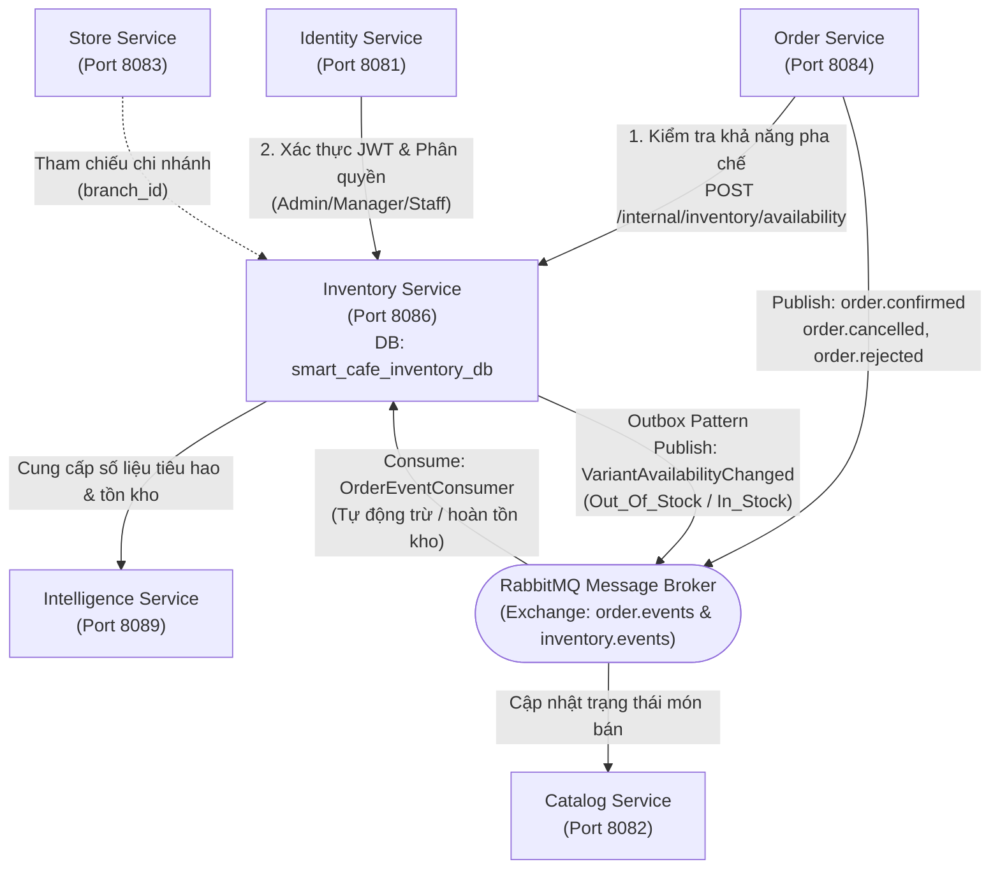
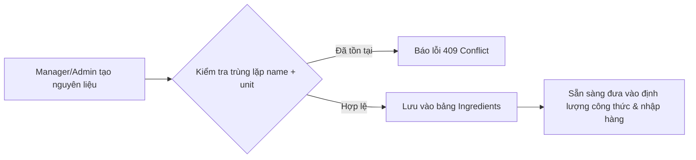
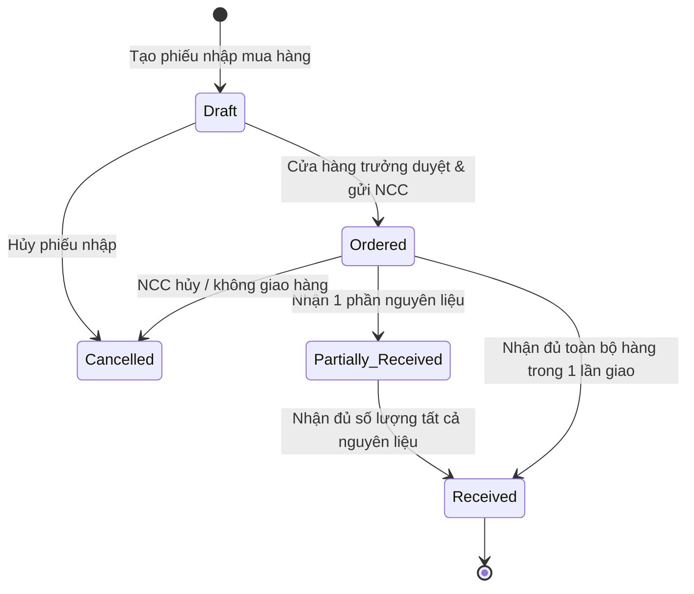
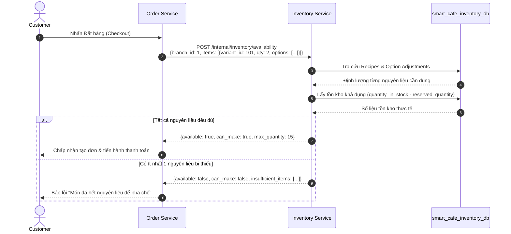
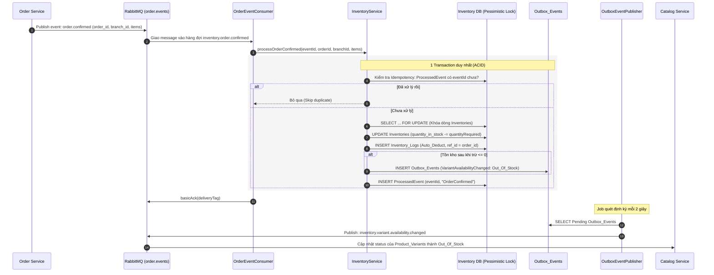

# Hướng Dẫn Nghiệp Vụ & Thiết Kế Kiến Trúc Inventory Service

> **Dự án:** Hệ thống Quản lý Chuỗi Cà phê Thông minh (Smart Café AI System)  
> **Dịch vụ:** `Inventory Service` (Quản lý Kho, Nguyên liệu & Giá vốn)  
> **Cổng dịch vụ (Port):** `8086` | **Prefix API Gateway:** `/inventory`  
> **Cơ sở dữ liệu:** `smart_cafe_inventory_db` (MySQL 8.0+)  
> **Message Broker:** RabbitMQ (`order.events`, `inventory.events`)  
> **Ngày cập nhật:** 27/10/2026 | **Phiên bản:** 2.0 (Toàn diện & Chi tiết hóa)

---

## 1. Tổng Quan & Vị Trí Của Inventory Service

Trong kiến trúc Microservices của hệ thống Smart Café AI, **Inventory Service** đóng vai trò là "trái tim vận hành tài sản hiện vật" của toàn bộ chuỗi cà phê. Dịch vụ chịu trách nhiệm đảm bảo tính chính xác về số lượng nguyên vật liệu, giá vốn thành phẩm, quy trình nhập mua từ nhà cung cấp, tự động khấu trừ kho khi bán hàng, cũng như dự báo và kiểm soát hao hụt.

### 1.1 Sơ đồ tương tác giữa Inventory Service và các Microservices



### 1.2 Các vai trò người dùng (Actors)
- **Admin (Quản trị viên hệ thống):** Quản lý danh mục nguyên liệu master toàn chuỗi, xem báo cáo tài chính kho, cấu hình hệ số tiêu chuẩn.
- **Store Manager (Cửa hàng trưởng):** Quản lý công thức (Recipes), tùy chỉnh định lượng option, lập & duyệt phiếu nhập hàng (Purchase Orders), ghi nhận thực nhận hàng (Receipts), kiểm kê kho định kỳ, báo hao hụt (Waste), tra cứu nhật ký và báo cáo chi nhánh.
- **Staff (Nhân viên pha chế/thu ngân):** Tra cứu số lượng tồn kho tức thời tại chi nhánh làm việc để chủ động tư vấn khách hàng.
- **Order Service (Hệ thống đặt hàng):** Tác nhân tự động gọi API nội bộ để kiểm tra tính khả thi của giỏ hàng và bắn sự kiện xác nhận/hủy đơn.

---

## 2. Chi Tiết 7 Luồng Nghiệp Vụ Cốt Lõi (Core Business Workflows)

---

### Luồng 1: Quản Lý Danh Mục Nguyên Liệu Master (Ingredients Management)

Quản lý danh sách các nguyên liệu cơ sở được sử dụng trong toàn chuỗi cà phê (ví dụ: Cà phê hạt Robusta, Sữa đặc, Sữa tươi tiệt trùng, Đường cát, Trà xanh Oolong, Siro Đào,...).

#### Các bước thực hiện:
1. **Thiết lập đơn vị tính cơ sở (`unit` - Base Unit):**
   - Đơn vị sử dụng trong kho và công thức pha chế **bắt buộc** là đơn vị nhỏ nhất tiện cho định lượng: gram (`g`), mililít (`ml`), hoặc cái (`cái`/`gói`).
   - Có ràng buộc duy nhất `UNIQUE(name, unit)` để chống việc trùng lặp nguyên liệu gây phân mảnh tồn kho.
2. **Theo dõi giá vốn bình quân di động (`average_cost`):**
   - Mỗi nguyên liệu có một giá vốn bình quân gia quyền đại diện tính trên 1 đơn vị cơ sở (VNĐ / g, VNĐ / ml).
   - Giá trị này được cập nhật tự động sau mỗi lần hoàn tất nhập kho từ nhà cung cấp.
3. **Kích hoạt / Tạm ngưng nguyên liệu (`is_active`):**
   - Hỗ trợ ẩn nguyên liệu không còn kinh doanh mà không phá vỡ tính toàn vẹn dữ liệu khóa ngoại lịch sử.



---

### Luồng 2: Quản Lý Công Thức Pha Chế (Recipes) & Điều Chỉnh Theo Tùy Chọn (Option Adjustments)

Luồng này giải quyết bài toán: **Một ly nước bán ra tiêu hao bao nhiêu nguyên liệu và có giá vốn (Cost Price) là bao nhiêu?**

#### 1. Công thức cơ sở theo biến thể món (`Recipes`):
- Mỗi biến thể món (`variant_id` - ví dụ: Cà phê Sữa đá Size M) được cấu thành từ danh sách các nguyên liệu với định lượng xác định (`quantity_required`):
  - *Ví dụ:* 25g Cà phê Robusta + 40ml Sữa đặc.
- **Tính toán Giá vốn biến thể (Cost Price):**
  $$\text{cost\_price} = \sum_{i=1}^{n} (\text{quantity\_required}_i \times \text{average\_cost}_i)$$
  - Giá vốn được tính theo `average_cost` của nguyên liệu tại chi nhánh (hoặc giá vốn master) giúp cửa hàng trưởng nắm ngay tỷ suất lợi nhuận gộp của từng món.

#### 2. Điều chỉnh định lượng theo tùy chọn khách chọn (`Option_Recipe_Adjustments`):
- Khi khách hàng gọi món kèm tùy chọn (Options): ví dụ "Thêm đường", "Ít ngọt", "Thêm 1 shot Espresso", "Đổi sữa hạt", định lượng nguyên liệu sẽ tăng/giảm tương ứng.
- Trường `quantity_delta` mang giá trị âm hoặc dương:
  - *Option "Thêm đường":* Nguyên liệu Đường có `quantity_delta = +10.0` (thêm 10g).
  - *Option "Giảm ngọt 50%":* Nguyên liệu Sữa đặc có `quantity_delta = -20.0` (giảm 20ml).
  - *Option "Đổi sữa hạt":* Sữa đặc `quantity_delta = -40.0`, Sữa hạt `quantity_delta = +40.0`.
- Khi tính toán tồn kho hay kiểm tra khả năng pha chế, hệ thống sẽ cộng dồn công thức gốc và các điều chỉnh delta của tùy chọn.

---

### Luồng 3: Quy Trình Mua Hàng & Nhập Kho (Purchase Orders - PO)

Quản lý chu trình cung ứng nguyên vật liệu từ Nhà cung cấp (Suppliers) về kho của từng Chi nhánh.

#### Vòng đời trạng thái Phiên Mua Hàng (PO Status Machine):



#### Quy trình chi tiết từng bước:
1. **Lập đơn đặt hàng (`POST /inventory/purchase-orders`):**
   - Chọn nhà cung cấp (`supplier_id`), chi nhánh tiếp nhận (`branch_id`).
   - Khai báo danh sách nguyên liệu cần mua với:
     - Đơn vị mua hàng sỉ (`purchase_unit`: kg, thùng, hộp, lít).
     - Hệ số quy đổi (`conversion_factor`): số đơn vị cơ sở trong 1 đơn vị mua (Ví dụ: 1 kg = 1000g $\rightarrow$ `conversion_factor = 1000`).
     - Số lượng mua và đơn giá mua tương ứng (`unit_price`).
   - Phiếu ban đầu ở trạng thái `Draft` hoặc `Pending`.
2. **Duyệt đơn mua (`POST /inventory/purchase-orders/{id}/order`):**
   - Đơn chuyển sang trạng thái `Ordered`, ghi nhận thời gian đặt (`ordered_at`), thời gian dự kiến giao hàng (`expected_at`) và người duyệt (`approved_by`).
3. **Ghi nhận phiếu nhận hàng thực tế (`POST /inventory/purchase-orders/{id}/receipts` hoặc `/complete`):**
   - Khi hàng về đến cửa hàng, nhân viên kiểm đếm số lượng thực nhận (`received_quantity`).
   - **Quy đổi về đơn vị chuẩn:**
     $$\text{added\_qty} = \text{received\_quantity} \times \text{conversion\_factor}$$
     $$\text{unit\_price\_base} = \frac{\text{unit\_price}}{\text{conversion\_factor}}$$
   - **Tính Giá vốn bình quân gia quyền di động (Moving Weighted Average Cost):**
     $$\text{average\_cost}_{\text{mới}} = \frac{(\text{quantity\_in\_stock}_{\text{cũ}} \times \text{average\_cost}_{\text{cũ}}) + (\text{added\_qty} \times \text{unit\_price\_base})}{\text{quantity\_in\_stock}_{\text{cũ}} + \text{added\_qty}}$$
   - **Cập nhật dữ liệu trong 1 DB Transaction:**
     - Tăng tồn kho `quantity_in_stock` tại bảng `Inventories`.
     - Cập nhật `average_cost` trong cả `Inventories` và `Ingredients`.
     - Ghi nhận `Inventory_Logs` với `transaction_type = 'Import'`.
     - Cập nhật trạng thái PO thành `Partially_Received` hoặc `Received` / `Completed`.
4. **Kích hoạt sự kiện phục hồi món bán:**
   - Hệ thống quét danh sách các biến thể liên quan đến nguyên liệu vừa nhập. Nếu tất cả các thành phần trong công thức của biến thể đó đều có tồn kho $> 0$, Inventory Service sẽ phát ra sự kiện Outbox `VariantAvailabilityChanged` (`In_Stock`) để Catalog Service tự động mở bán lại món đó.

---

### Luồng 4: Kiểm Tra Khả Năng Pha Chế (Availability Check - Synchronous Internal API)

Được gọi đồng bộ từ **Order Service** trước khi cho phép khách thanh toán hoặc xác nhận đơn hàng, nhằm đảm bảo không nhận đơn cho những món đã hết nguyên liệu.



#### Công thức kiểm tra:
1. Với mỗi sản phẩm trong giỏ:
   $$\text{Lượng nguyên liệu cần 1 ly} = \text{Định lượng công thức gốc} + \sum (\text{Option Delta} \times \text{Số lượng option})$$
   $$\text{Tổng nhu cầu nguyên liệu} = \text{Lượng cần 1 ly} \times \text{Số lượng ly đặt}$$
2. So sánh với tồn khả dụng:
   $$\text{Tồn khả dụng} = \text{quantity\_in\_stock} - \text{reserved\_quantity}$$
   - Nếu $\text{Tồn khả dụng} < \text{Tổng nhu cầu}$: Bổ sung vào danh sách `insufficient_items` và `missing_ingredients`.
   - Tính toán `max_quantity` có thể làm tối đa: $\min \left( \lfloor \frac{\text{Tồn khả dụng}}{\text{Lượng cần 1 ly}} \rfloor \right)$ trên tất cả nguyên liệu của món.

---

### Luồng 5: Tự Động Khấu Trừ & Hoàn Trả Kho Theo Sự Kiện Đơn Hàng (Event-Driven Auto-Deduct & Refund)

Luồng xử lý hoàn toàn **bất đồng bộ (asynchronous)** dựa trên Message Broker (RabbitMQ), đảm bảo hiệu năng cao và phân tách độc lập (decoupling) giữa Order Service và Inventory Service.



#### Xử lý khi Hủy đơn / Từ chối đơn (`order.cancelled` / `order.rejected`):
1. Consumer nhận sự kiện hủy đơn.
2. Kiểm tra `ProcessedEvent`.
3. Khóa dòng tồn kho `PESSIMISTIC_WRITE`.
4. Cộng hoàn lại số nguyên liệu tương ứng:
   $$\text{quantity\_in\_stock} = \text{quantity\_in\_stock} + \text{quantityToRefund}$$
5. Ghi log `Inventory_Logs` với loại `Refund`.
6. Nếu tồn kho trước đó $\le 0$ và sau khi hoàn lại trở nên $> 0$, tự động ghi sự kiện Outbox `VariantAvailabilityChanged` (`In_Stock`) để mở bán lại trên menu.

---

### Luồng 6: Kiểm Kê Kho & Điều Chỉnh Hao Hụt (Stock Adjustments & Waste)

Quản lý việc kiểm đếm thực tế và xử lý các sự cố phát sinh tại cửa hàng.

#### 1. Ghi nhận Hao Hụt (`transaction_type = Waste`):
- Áp dụng khi nguyên vật liệu bị:
  - Rơi vỡ, đổ hỏng trong quá trình pha chế.
  - Hết hạn sử dụng (hết date).
  - Hư hỏng do bảo quản (tủ lạnh mất điện, rách bao bì).
- Tồn kho bị trừ trực tiếp: `quantity_in_stock = quantity_in_stock - abs(quantity_changed)`.
- Bắt buộc phải có lý do cụ thể (`reason`) và định danh người báo (`created_by`).
- Không cho phép trừ vượt quá số lượng tồn kho đang có trong hệ thống (`INSUFFICIENT_STOCK`).

#### 2. Điều chỉnh kiểm kê định kỳ (`transaction_type = Adjustment` / `Stocktake`):
- Cuối ngày hoặc cuối tuần, cửa hàng trưởng cân đo thực tế số lượng trong kho.
- Nếu thực tế lệch so với phần mềm:
  - Nhập số lượng chênh lệch (dương nếu dư, âm nếu thiếu).
  - Hệ thống cập nhật số dư mới `balance_after` và lưu vết kiểm toán.

---

### Luồng 7: Báo Cáo Tài Chính Kho, Hao Hụt & Tiêu Hao (Reports)

Cung cấp số liệu chính xác phục vụ quản trị chi phí và kế toán quản trị.

1. **Báo cáo chi phí (`GET /inventory/reports/costs`):**
   - **Chi phí nhập hàng (Purchase Cost):** Tổng giá trị các phiếu nhập hàng đã hoàn tất (`Completed`) trong kỳ.
   - **Chi phí hao hụt (Waste Cost):** 
     $$\text{Waste Cost} = \sum (\text{Số lượng hao hụt} \times \text{average\_cost})$$
   - **Giá vốn hàng bán (COGS - Cost of Goods Sold):** 
     $$\text{COGS} = \sum (\text{Số lượng xuất bán Auto\_Deduct} \times \text{average\_cost}) - \sum (\text{Số lượng hoàn trả Refund} \times \text{average\_cost})$$
2. **Báo cáo tiêu hao nguyên liệu (`GET /inventory/reports/usage`):**
   - Thống kê chi tiết cho từng nguyên liệu:
     - Lượng bán ra (`auto_deduct_quantity`).
     - Lượng hao hụt (`waste_quantity`).
     - Lượng hoàn trả (`refund_quantity`).
     - Lượng tiêu hao ròng: $\text{Net Usage} = \text{Auto\_Deduct} + \text{Waste} - \text{Refund}$.

---

## 3. Các Điểm Kỹ Thuật Cần Lưu Ý Cực Kỳ Quan Trọng (Critical Considerations)

### 3.1 Chống Race Condition & Tranh Chấp Tồn Kho (Concurrency Control)
- **Vấn đề:** Khi vào giờ cao điểm, hàng chục đơn hàng được xác nhận đồng thời tại cùng 1 chi nhánh, nếu 2 tiến trình cùng đọc tồn kho là `50g` rồi cùng trừ `25g` mà không khóa, tồn kho cuối cùng có thể sai lệch hoặc gây tồn âm.
- **Giải pháp áp dụng:**
  - Sử dụng **Pessimistic Locking** (`SELECT ... FOR UPDATE`) thông qua Spring Data JPA `@Lock(LockModeType.PESSIMISTIC_WRITE)` trong phương thức `findByBranchIdAndIngredientIdForUpdate`.
  - Toàn bộ chuỗi thao tác: Khóa bản ghi $\rightarrow$ Trừ/Cộng kho $\rightarrow$ Ghi log $\rightarrow$ Tạo sự kiện Outbox $\rightarrow$ Commit phải nằm trọn vẹn trong **1 `@Transactional`**.
  - Bảng `Inventories` được trang bị thêm cột `@Version private Long version` để hỗ trợ Optimistic Locking khi nhân viên kiểm kê thủ công trên giao diện web, ngăn việc 2 nhân viên ghi đè kết quả kiểm kê của nhau.

### 3.2 Đảm Bảo Độ Tin Cậy Với Transactional Outbox Pattern
- **Vấn đề:** Nếu cập nhật DB thành công nhưng việc gửi message sang RabbitMQ gặp sự cố mạng (network partition / RabbitMQ restart), sự kiện thay đổi tồn kho sẽ bị mất vĩnh viễn (Dual-write problem).
- **Giải pháp áp dụng:**
  - Không bao giờ gọi trực tiếp `rabbitTemplate.convertAndSend` trong nghiệp vụ chính.
  - Lưu sự kiện vào bảng `Outbox_Events` với trạng thái `Pending` ngay trong cùng DB Transaction của nghiệp vụ.
  - Background Scheduler (`OutboxEventPublisher`) chạy định kỳ mỗi 2 giây:
    - Quét 50 sự kiện `Pending` xếp theo thời gian tạo.
    - Bắn lên RabbitMQ Topic Exchange `inventory.events`.
    - Khi thành công, đổi trạng thái sang `Published`.
    - Nếu thất bại, ghi `last_error` và chuyển sang `Failed`.
  - Một Job phụ chạy mỗi 30 giây sẽ tự động quét và thử lại (retry) các sự kiện `Failed`.

### 3.3 Tính Bất Biến Khi Xử Lý Trùng Lặp Sự Kiện (Idempotency)
- **Vấn đề:** Trong mạng phân tán, RabbitMQ có chính sách "At-least-once delivery" (chuyển giao ít nhất một lần). Nếu mạng chập chờn khi gửi Ack, một message `order.confirmed` có thể bị gửi lại lần 2. Nếu không kiểm soát, kho sẽ bị trừ 2 lần!
- **Giải pháp áp dụng:**
  - Bảng `Processed_Events` lưu giữ `event_id` và `event_type`.
  - Đầu phương thức `processOrderConfirmed` và `processOrderCancelled`:
    ```java
    if (processedEventRepository.existsByEventId(eventId)) {
        log.info("Event {} already processed, skipping", eventId);
        return;
    }
    ```
  - Trong bảng `Inventory_Logs`, cột `idempotency_key` (ví dụ `order:10024:ing:12:deduct`) được đặt chỉ mục `UNIQUE` để bảo vệ ở cả tầng Database constraint.

### 3.4 Quy Chuẩn Đơn Vị Tính & Quy Đổi Khi Nhập Kho (Unit Conversion)
- Cần phân định rạch ròi 2 khái niệm đơn vị:
  - **Base Unit (Đơn vị cơ sở/kho):** Thường là `g`, `ml`, `cái`. Tất cả tồn kho trong `Inventories` và công thức trong `Recipes` đều dùng đơn vị này.
  - **Purchase Unit (Đơn vị mua):** Thường là `kg`, `hộp`, `thùng`, `lít`.
- Khi lập PO, bắt buộc phải có `conversion_factor`:
  - *Ví dụ 1:* Mua 5 kg cà phê hạt với giá 200.000 VNĐ/kg $\rightarrow$ `quantity = 5`, `purchase_unit = "kg"`, `conversion_factor = 1000`, `unit_price = 200000`.
  - Khi cộng kho: `addedQty = 5 * 1000 = 5000g`.
  - Đơn giá trên đơn vị cơ sở: `unitPriceBase = 200000 / 1000 = 200 VNĐ/g`.
  - Dùng `unitPriceBase` và `addedQty` này để tính Giá vốn bình quân mới.

### 3.5 Công Thức Giá Vốn Khi Tồn Kho Cũ Bị Âm
- **Quy tắc vàng:** Nếu tại thời điểm nhập hàng, số lượng tồn cũ trong kho đang âm (do cửa hàng đã bán hàng trước khi kế toán kịp nhập phiếu PO vào hệ thống), thì lượng tồn cũ khi tính giá vốn phải được quy ước là `0`:
  ```java
  BigDecimal oldStock = inventory.getQuantityInStock().max(BigDecimal.ZERO);
  ```
  *Lý do:* Nếu để số lượng âm vào công thức bình quân gia quyền, mẫu số $(\text{Tồn cũ} + \text{Nhập})$ sẽ bị co nhỏ và tử số bị méo mó, dẫn đến giá vốn tính ra bị sai lệch nghiêm trọng.

### 3.6 Cơ Chế Giữ Chỗ Tồn Kho (Stock Reservation Pattern - Dự phòng mở rộng)
- Bảng `Stock_Reservations` và cột `reserved_quantity` trong `Inventories` đã được thiết kế sẵn để hỗ trợ bài toán:
  - Khi khách đặt hàng Online qua cổng thanh toán VNPay/Momo, đơn hàng ở trạng thái `Pending_Payment`.
  - Hệ thống tăng `reserved_quantity` và sinh bản ghi trong `Stock_Reservations` với thời gian hết hạn (`expires_at`, ví dụ 15 phút).
  - Tồn kho khả dụng để bán cho khách khác = $\text{quantity\_in\_stock} - \text{reserved\_quantity}$.
  - Nếu thanh toán thành công: Chuyển trạng thái reservation thành `Committed`, trừ `quantity_in_stock` và giải phóng `reserved_quantity`.
  - Nếu quá hạn 15 phút không thanh toán: Job tự động giải phóng reservation (`Released`), hoàn lại `reserved_quantity` cho khách khác mua.

---

## 4. Danh Mục 31 API Chi Tiết Của Inventory Service

Dịch vụ hỗ trợ đồng thời cả prefix `/inventory/...` (thông qua API Gateway) và direct URL nội bộ:

### Nhóm 1: Quản lý Nguyên liệu (Ingredients - 5 APIs)
| Method | Endpoint | Vai trò | Chức năng |
| :--- | :--- | :--- | :--- |
| `POST` | `/inventory/ingredients` | ADMIN | Thêm nguyên liệu master mới |
| `GET` | `/inventory/ingredients` | MANAGER, ADMIN | Tìm kiếm, lọc và phân trang danh mục nguyên liệu |
| `GET` | `/inventory/ingredients/{id}` | MANAGER, ADMIN | Xem chi tiết 1 nguyên liệu |
| `PUT` | `/inventory/ingredients/{id}` | ADMIN | Cập nhật thông tin nguyên liệu |
| `PATCH` | `/inventory/ingredients/{id}/active` | ADMIN | Bật/tắt kích hoạt nguyên liệu |

### Nhóm 2: Quản lý Nhà Cung Cấp (Suppliers - 5 APIs)
| Method | Endpoint | Vai trò | Chức năng |
| :--- | :--- | :--- | :--- |
| `POST` | `/inventory/suppliers` | MANAGER, ADMIN | Tạo nhà cung cấp mới |
| `GET` | `/inventory/suppliers` | MANAGER, ADMIN | Lọc và phân trang danh sách nhà cung cấp |
| `GET` | `/inventory/suppliers/{id}` | MANAGER, ADMIN | Xem thông tin chi tiết nhà cung cấp |
| `PUT` | `/inventory/suppliers/{id}` | MANAGER, ADMIN | Cập nhật thông tin nhà cung cấp |
| `PATCH` | `/inventory/suppliers/{id}/status` | MANAGER, ADMIN | Chuyển đổi trạng thái Active / Inactive |

### Nhóm 3: Phiếu Mua Hàng & Nhập Kho (Purchase Orders - 7 APIs)
| Method | Endpoint | Vai trò | Chức năng |
| :--- | :--- | :--- | :--- |
| `POST` | `/inventory/purchase-orders` | MANAGER, ADMIN | Tạo phiếu nhập hàng ở trạng thái Draft |
| `GET` | `/inventory/purchase-orders` | MANAGER, ADMIN | Danh sách phiếu nhập hàng theo chi nhánh, NCC, trạng thái |
| `GET` | `/inventory/purchase-orders/{id}` | MANAGER, ADMIN | Chi tiết phiếu nhập hàng và danh sách mặt hàng |
| `PUT` | `/inventory/purchase-orders/{id}` | MANAGER, ADMIN | Cập nhật phiếu nhập ở trạng thái Draft / Pending |
| `POST` | `/inventory/purchase-orders/{id}/order` | MANAGER, ADMIN | Duyệt và chuyển trạng thái sang Ordered |
| `POST` | `/inventory/purchase-orders/{id}/receipts` | MANAGER, ADMIN | Ghi nhận thực nhận hàng từng phần/toàn phần, cộng kho & tính giá vốn |
| `POST` | `/inventory/purchase-orders/{id}/cancel` | MANAGER, ADMIN | Hủy phiếu nhập hàng chưa hoàn tất |

### Nhóm 4: Tồn Kho & Biến Động Kho (Stocks & Logs - 3 APIs)
| Method | Endpoint | Vai trò | Chức năng |
| :--- | :--- | :--- | :--- |
| `GET` | `/inventory/stocks` | STAFF, MANAGER, ADMIN | Tra cứu tồn kho thực tế theo chi nhánh và nguyên liệu |
| `POST` | `/inventory/stocks/adjustments` | MANAGER, ADMIN | Kiểm kê điều chỉnh tồn kho hoặc ghi nhận hao hụt (Waste) |
| `GET` | `/inventory/logs` | MANAGER, ADMIN | Xem nhật ký truy vết xuất-nhập-tồn chi tiết |

### Nhóm 5: Công Thức Pha Chế (Recipes - 6 APIs)
| Method | Endpoint | Vai trò | Chức năng |
| :--- | :--- | :--- | :--- |
| `PUT` | `/inventory/recipes/variants/{variantId}` | MANAGER, ADMIN | Thiết lập hoặc thay thế toàn bộ công thức cho một biến thể |
| `POST` | `/inventory/recipes/variants/{variantId}/items` | MANAGER, ADMIN | Thêm 1 dòng nguyên liệu vào công thức biến thể |
| `GET` | `/inventory/recipes` | MANAGER, ADMIN | Danh sách công thức các biến thể kèm tổng chi phí giá vốn |
| `GET` | `/inventory/recipes/variants/{variantId}` | MANAGER, ADMIN | Xem chi tiết công thức và giá vốn của một biến thể |
| `PUT` | `/inventory/recipes/{id}` | MANAGER, ADMIN | Cập nhật định lượng của một dòng nguyên liệu trong công thức |
| `DELETE`| `/inventory/recipes/{id}` | MANAGER, ADMIN | Xóa một dòng nguyên liệu khỏi công thức |

### Nhóm 6: Điều Chỉnh Định Lượng Theo Tùy Chọn (Option Adjustments - 2 APIs)
| Method | Endpoint | Vai trò | Chức năng |
| :--- | :--- | :--- | :--- |
| `PUT` | `/inventory/options/{optionId}/recipe-adjustments` | MANAGER, ADMIN | Thiết lập định lượng tăng/giảm của nguyên liệu cho 1 Option |
| `GET` | `/inventory/options/{optionId}/recipe-adjustments` | MANAGER, ADMIN | Xem danh sách định lượng tăng/giảm theo Option |

### Nhóm 7: Báo Cáo Thống Kê Kho (Reports - 2 APIs)
| Method | Endpoint | Vai trò | Chức năng |
| :--- | :--- | :--- | :--- |
| `GET` | `/inventory/reports/costs` | MANAGER, ADMIN | Báo cáo chi phí nhập mua, chi phí hao hụt và giá vốn COGS |
| `GET` | `/inventory/reports/usage` | MANAGER, ADMIN | Báo cáo chi tiết sản lượng tiêu hao ròng của từng nguyên liệu |

### Nhóm 8: Internal API Dành Cho Order Service (1 API)
| Method | Endpoint | Xác thực | Chức năng |
| :--- | :--- | :--- | :--- |
| `POST` | `/internal/inventory/availability` | Internal (No Auth) | Kiểm tra khả năng pha chế của danh sách sản phẩm trong giỏ hàng |

---

## 5. Bảng Đặc Tả Sự Kiện RabbitMQ (Event Specification)

### 5.1 Sự Kiện Tiếp Nhận (Consumed Events)
- **Topic Exchange:** `order.events`
- **Các Hàng Đợi (Queues):**
  1. `inventory.order.confirmed` (Routing key: `order.confirmed`):
     - **Hành động:** Phân tích công thức món $\rightarrow$ Trừ tồn kho chi nhánh $\rightarrow$ Ghi log `Auto_Deduct`.
  2. `inventory.order.cancelled` (Routing key: `order.cancelled`):
     - **Hành động:** Hoàn trả nguyên liệu về kho $\rightarrow$ Ghi log `Refund`.
  3. `inventory.order.rejected` (Routing key: `order.rejected`):
     - **Hành động:** Tương tự như hủy đơn, hoàn trả nguyên liệu về kho $\rightarrow$ Ghi log `Refund`.

### 5.2 Sự Kiện Phát Ra (Published Events qua Outbox Pattern)
- **Topic Exchange:** `inventory.events`
- **Routing Keys:**
  1. `inventory.variant.availability.changed`:
     - Phát khi một nguyên liệu bị hết dẫn đến món chuyển sang `Out_Of_Stock`, hoặc khi nguyên liệu vừa được nhập thêm đủ để món chuyển lại thành `In_Stock`.
     - **Subscriber:** Catalog Service nhận sự kiện để cập nhật cờ hiển thị trên menu đặt món.
  2. `inventory.purchase_order.completed`:
     - Phát khi một phiếu nhập hàng được hoàn tất.

---

## 6. Tổng Kết & Checklist Khi Triển Khai Thực Tế

> [!IMPORTANT]
> Khi vận hành hoặc mở rộng Inventory Service, luôn tuân thủ 5 nguyên tắc sau:
> 1. **Tuyệt đối không trừ kho trực tiếp khi khách mới chỉ thêm vào giỏ hàng:** Chỉ trừ kho khi có sự kiện `order.confirmed` (đơn hàng đã được xác nhận). Nếu cần giữ chỗ trước khi khách thanh toán trực tuyến, bắt buộc sử dụng cơ chế `Stock_Reservations` với thời gian hết hạn (`expires_at`).
> 2. **Luôn sử dụng `SELECT ... FOR UPDATE`** khi cập nhật tồn kho để ngăn chặn xung đột dữ liệu giữa nhiều đơn hàng song song.
> 3. **Bắt buộc áp dụng Transactional Outbox Pattern** để đảm bảo dữ liệu trong DB và thông điệp gửi lên RabbitMQ luôn đồng nhất 100%.
> 4. **Kiểm tra tính Idempotency của mọi Event Consumer:** Luôn lưu `event_id` vào `Processed_Events` trước khi thực thi để tránh trừ kho trùng lặp khi message broker gửi lại gói tin.
> 5. **Quy chuẩn đơn vị Base Unit:** Luôn quy đổi đơn vị mua sỉ (`purchase_unit`) về đơn vị cơ sở chuẩn (`g`, `ml`) trước khi tính giá vốn bình quân và cộng vào kho.
