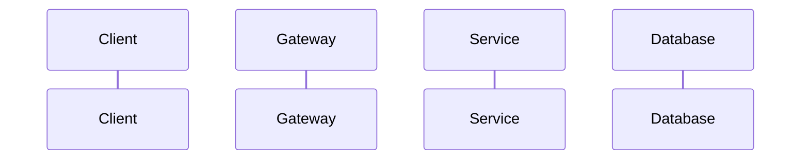

# [Service Name] Specification

## 1. Document Information
- **Document Title:** [Service Name] System Architecture & Specification
- **Service Name:** `[service-name]`
- **Database:** `[database_name]`
- **Base Port (Suggested):** `[808X]`
- **Gateway Prefix:** `[/prefix]`
- **Version:** `1.0`
- **Date:** `28/09/2026`
- **Author:** Smart Café AI Architecture Team

---

## 2. Service Overview
[Mô tả tổng quan vai trò của service trong kiến trúc microservices]

---

## 3. Responsibilities & Scope
### 3.1 Responsibilities
- [Trách nhiệm 1]
- [Trách nhiệm 2]

### 3.2 In Scope
- [Nghiệp vụ trong phạm vi 1]
- [Nghiệp vụ trong phạm vi 2]

### 3.3 Out of Scope
- [Nghiệp vụ không thuộc phạm vi]

---

## 4. Actors
- **Customer:** [Quyền hạn/Tương tác]
- **Staff:** [Quyền hạn/Tương tác]
- **Manager:** [Quyền hạn/Tương tác]
- **Admin:** [Quyền hạn/Tương tác]
- **System / Internal Services:** [Tương tác dịch vụ nội bộ]

---

## 5. Business Functions
- **Group 1:** [Tên nhóm 1]
- **Group 2:** [Tên nhóm 2]

---

## 6. Database Ownership
### 6.1 Database
- **DB Name:** `[database_name]`
- **Engine:** MySQL 8.0+
- **Charset:** `utf8mb4` / `utf8mb4_unicode_ci`

### 6.2 Owned Tables
[Schema chi tiết từng bảng]

### 6.3 External References
[Các ID tham chiếu tới service khác]

---

## 7. Business Rules
- **[BR-01]:** [Quy tắc 1]
- **[BR-02]:** [Quy tắc 2]

---

## 8. State / Status Flow
[Sơ đồ và quy tắc chuyển trạng thái]

---

## 9. API Specification
### 9.1 API Summary
| STT | Group | Method | Endpoint | Description | Auth | DB Tables |
|---|---|---|---|---|---|---|

### 9.2 API Details
[Chi tiết từng API Endpoint]

---

## 10. Event Specification
### 10.1 Published Events
- **Event:** `[EventName]`

### 10.2 Consumed Events
- **Event:** `[EventName]`

---

## 11. Dependencies & Service Integration
- **Synchronous Integration (REST):** [Service & API]
- **Asynchronous Integration (Outbox / Broker):** [Topics & Payload]

---

## 12. Error Handling
| Code | HTTP Status | Description |
|---|---|---|

---

## 13. Security & Authorization
- **Authentication:** JWT Bearer Token
- **RBAC Roles:** `Customer`, `Staff`, `Manager`, `Admin`
- **Data Scoping:** Enforce `branch_id` / `user_id`

---

## 14. Sequence Flow

---

## 15. Non-functional Requirements
- **Performance:** Response time < 200ms
- **Idempotency:** Idempotency Key header
- **Audit Logging:** System_Logs integration

---

## 16. Open Issues / Decision Log
- **[GAP-01]:** [Vấn đề DB & DDL đề xuất]
